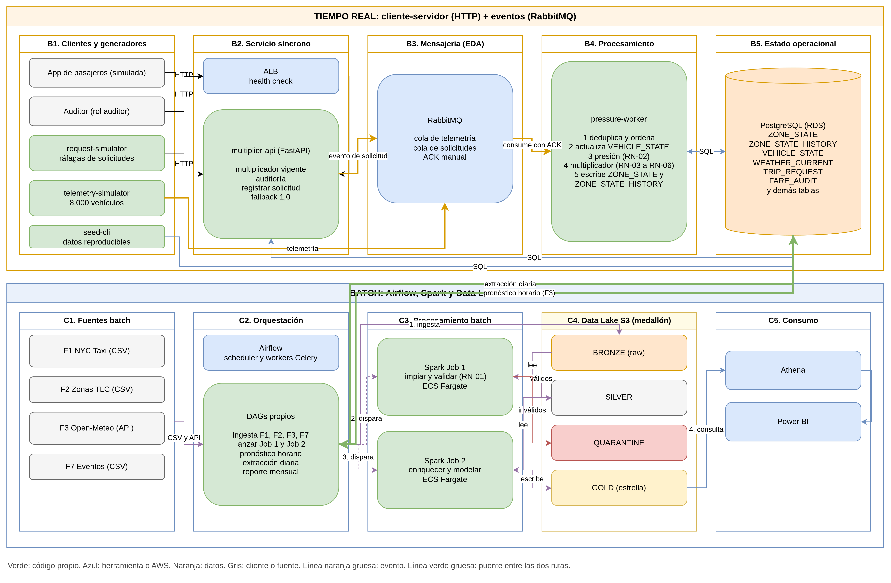

# Pipeline End-to-End

El flujo de procesamiento de datos de RutaViva opera en dos velocidades sincronizadas: la **Ruta Batch (Analítica)** y la **Ruta Casi Tiempo Real (Operacional)**.

---

## 1. Las Dos Franjas del Pipeline

---

## 2. Arquitectura Medallón del Data Lake (Batch)

| Capa | Almacenamiento | Quién Escribe | Quién Lee | Reglas y Formatos |
|---|---|---|---|---|
| **Bronze (Raw)** | AWS S3 (`raw/`) | Airflow (ingesta diaria/mensual) | Spark Job 1 & 2 | Formato nativo (CSV/JSON), particionado por año/mes. Inmutable. |
| **Silver (Conformed)** | AWS S3 (`silver/`) | Spark Job 1 | Spark Job 2 | Parquet columnar. Esquema unificado entre diferentes años. Tipado estricto. |
| **Quarantine (Anomalías)** | AWS S3 (`quarantine/`) | Spark Job 1 | Analistas de calidad | Viajes inválidos (distancia menor o igual a 0, tarifa negativa, duración mayor a 300 min, zonas inexistentes) con columna `reject_reason`. |
| **Gold (Curated)** | AWS S3 (`gold/`) | Spark Job 2 | Amazon Athena / Power BI | Tablas de hechos (`FACT_TRIP`, `FACT_ZONE_INTERVAL`) y dimensiones planas. Optimizado para consultas analíticas. |

---

## 3. Flujo en Tiempo Real: Telemetría a Multiplicador

1. **Generación (F4)**: `telemetry_simulator` genera coordenadas cada 15s para ~8,000 vehículos y resuelve la zona con su índice espacial R-Tree.
2. **Ingesta**: Publicación asíncrona por lotes en RabbitMQ (`telemetria.viajes` -> `telemetria.vehiculos`).
3. **Cálculo de Presión**: `pressure_worker` consume los mensajes, evalúa la ventana móvil de vehículos libres (menor o igual a 2 min según RN-10) y solicitudes recientes (menor o igual a 10 min).
4. **Tarificación**: Aplica la función de tarifa dinámica escalonada, lluvia de `weather_current` y topes regulatorios.
5. **Persistencia**: Actualiza `zone_state` y registra la serie temporal en `zone_state_history`.
6. **Consulta**: `multiplier_api` lee `zone_state` por clave primaria en milisegundos para cotizar a la aplicación de pasajeros.
