# Puntos Abiertos, Supuestos y Tensiones Arquitectónicas

Este documento consolida los análisis críticos, supuestos de diseño y tensiones técnicas identificadas en las notas de arquitectura de Obsidian para RutaViva.

---

## 1. Supuestos de Diseño Adoptados

Decisiones tomadas durante el diseño que requieren confirmación continua durante la evolución de los Sprints:

| # | Supuesto Adoptado | Alternativa Descartada | Razón Técnica |
|---|---|---|---|
| **1** | `VEHICLE_STATE` como tabla en PostgreSQL | Mantener el estado de flota solo en la memoria RAM del worker | Si el worker se reinicia o cae, se perdería el estado cinemático de los 8,000 vehículos. La tabla permite recuperación rápida. |
| **2** | `ZONE_STATE_HISTORY` separada de `ZONE_STATE` | Guardar el histórico en la misma tabla `ZONE_STATE` | La API exige responder en milisegundos consultando por clave primaria (RNF-01). Millones de registros históricos degradarían los índices calientes. |
| **3** | `FACT_QUARANTINE` particionado por `source_month` | Unir cuarentena a una clave de fecha de viaje | Un viaje rechazado puede traer fechas nulas, futuras o incoherentes (motivo de rechazo en RN-01). El mes del lote de origen es seguro e inmutable. |
| **4** | Eventos especiales como bandera booleana `is_special_event` en `FACT_TRIP` | Dimensión separada `DIM_EVENT` | Evita *joins* innecesarios en Power BI para consultas analíticas agregadas donde la mayoría de viajes no coinciden con eventos. |
| **5** | Copia desacoplada de valores en `FARE_AUDIT` | Enlazar mediante claves foráneas hacia `WEATHER_CURRENT` y `ZONE_STATE` | Si el clima o la presión se corrigen retroactivamente, la auditoría debe conservar exactamente la foto del valor con el que se cobró (RN-12). |

---

## 2. La Tensión del Health Check (ALB vs. Degradación Segura)

El enunciado del proyecto exige que el health check del **Application Load Balancer (ALB)** valide la dependencia de la base de datos (tema 9). Sin embargo, esto genera una tensión directa con la **Degradación Segura (RNF-04)**:

```mermaid
flowchart TD
    subgraph Escenario A: Worker Detenido
        A1[Worker caído / Dato viejo > 300s] --> A2[PostgreSQL responde OK]
        A2 --> A3[ALB Health Check: SANO 200]
        A3 --> A4[API responde multiplicador 1.0 degraded: true]
        A4 --> A5[Cumple RNF-04 con éxito]
    end

    subgraph Escenario B: PostgreSQL Totalmente Caído
        B1[PostgreSQL colapsado] --> B2[ALB Health Check valida BD]
        B2 --> B3[Instancias marcadas NO SANAS]
        B3 --> B4[ALB responde 503 Service Unavailable]
        B4 -.->|Contradicción| B5[No se puede entregar 1.0 degradado]
    end
```

### Solución Arquitectónica Adoptada
Separar los endpoints de monitoreo:
* **`/health/live`**: Valida únicamente si el proceso FastAPI está vivo y puede servir tráfico (para reinicio de contenedores).
* **`/health/ready`**: Valida la conectividad hacia PostgreSQL y RabbitMQ.
* En el **ADR-0007 (Pendiente)** se formalizará si el target group del ALB debe apuntar a `/health/live` con fallback degradado en memoria, o aceptar el 503 en caída total de base de datos.

---

## 3. Puntos Abiertos Pendientes de Resolución

1. **Retención de `FARE_AUDIT` (RNF-05)**:
   * Debe conservarse por 24 meses. ¿Cuánto tiempo reside en PostgreSQL operacional y a partir de qué mes se archiva a Parquet en S3 mediante un DAG de Airflow?
2. **Cero Vehículos Libres (División por cero en RN-02)**:
   * La fórmula `Presión = Demanda / Oferta` es indeterminada si `Oferta = 0`.
   * *Propuesta del equipo*: Si hay solicitudes y oferta 0 ➔ Presión máxima (multiplicador 1.8 / 2.0). Si no hay solicitudes ni oferta ➔ Multiplicador base 1.0.
3. **Escalón de Lluvia sobre Multiplicador 1.8**:
   * Si la presión fija la tarifa en 1.8 y llueve `> 2 mm/h`, ¿sube a 2.0?
   * *Propuesta del equipo*: Sí, sube a 2.0 respetando el tope máximo regulatorio de RN-05.
4. **Comportamiento si RabbitMQ no responde durante una Solicitud**:
   * Si al crear un viaje en `POST /trip-requests` falla la publicación del evento a RabbitMQ, la API debe responder exitosamente al pasajero y persistir en BD, ya que perder el evento solo afecta marginalmente el conteo de demanda futura.
5. **Cortes de Categoría de Lluvia (`rain_category`)**:
   * El enunciado solo fija el umbral de 2 mm/h. El equipo debe definir los rangos (ej. Ligera: 0-2 mm/h, Moderada: 2-5 mm/h, Fuerte: $>5$ mm/h).
6. **Multiplicador de los Viajes Históricos de F1**:
   * Los archivos históricos de la TLC (F1) traen tarifa fija real sin multiplicador dinámico. Para el modelo analítico (`FACT_TRIP`), ¿dónde y con qué oferta sintética se recalcula el multiplicador histórico?
