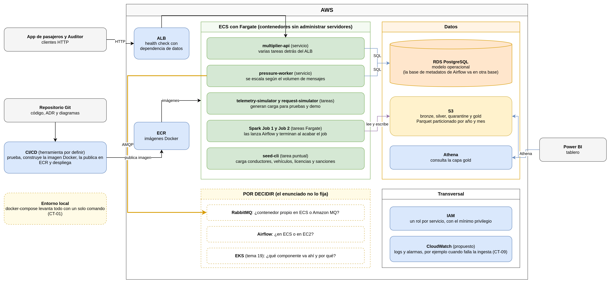

# Arquitectura Global de RutaViva

La arquitectura de **RutaViva** está diseñada bajo un enfoque híbrido que combina:
1. **Arquitectura Orientada a Eventos (EDA)** como estilo principal para la ingesta reactiva de telemetría y absorción de picos de demanda mediante colas de mensajería asíncrona.
2. **Arquitectura Cliente-Servidor** para la exposición de endpoints REST de baja latencia consumidos por aplicaciones de pasajeros, conductores y auditores.
3. **Arquitectura en Capas Limpias** dentro de cada microservicio para separar las interfaces de transporte (HTTP/AMQP), la lógica pura del negocio y el acceso a datos.

---

## Diagrama de Bloques General

---

## Justificación de Tecnologías

* **RabbitMQ**: Desacopla la producción masiva de coordenadas GPS de la tasa de procesamiento y escritura en base de datos.
* **PostgreSQL (RDS)**: Almacén operacional ACID con soporte relacional estricto para licencias, sanciones, conductores y auditorías de viaje.
* **FastAPI**: Microframework asíncrono en Python con tipado estricto (Pydantic v2) que permite entregar respuestas en p95 menor a 150 ms.
* **Apache Spark**: Procesamiento distribuido en memoria para limpiar, validar y transformar millones de registros históricos (NYC Yellow Taxi).
* **Apache Airflow**: Scheduler declarativo con manejo de reintentos e idempotencia para ingesta batch y actualización periódica de clima.
