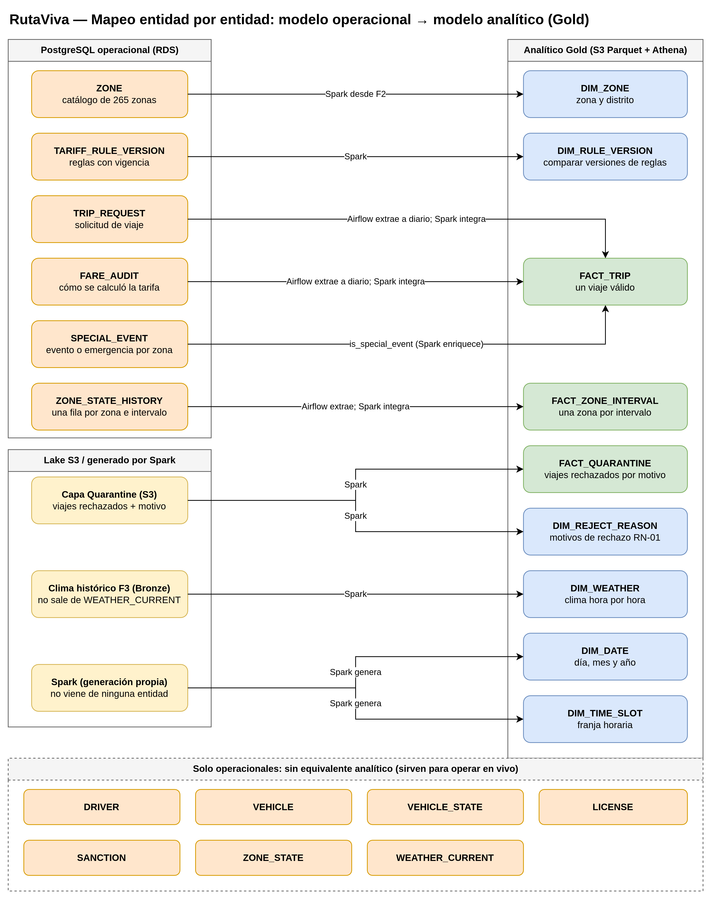

# Correspondencia entre Modelo Operacional y Analítico

Este documento detalla la trazabilidad y transformación que sufren las entidades operacionales de **PostgreSQL** para convertirse en las tablas analíticas del modelo dimensional en **AWS S3 / Athena (Capa Gold)**.

---

## 1. Mapeo Entidad por Entidad

---

## 2. Matriz de Transformación

| Entidad Operacional (PostgreSQL) | Entidad Analítica (Gold / Lake) | Mecanismo de Ingesta y Transformación | Notas de Diseño |
|---|---|---|---|
| **`ZONE`** | **`DIM_ZONE`** | Spark desde F2 (TLC) | Ambas provienen del mismo catálogo oficial de 265 zonas de NYC. |
| **`TARIFF_RULE_VERSION`** | **`DIM_RULE_VERSION`** | Spark desde PostgreSQL / Config | Permite comparar el rendimiento financiero y tiempos de espera entre distintas versiones de reglas (RF-08). |
| **`TRIP_REQUEST` y `FARE_AUDIT`** | **`FACT_TRIP`** | Airflow extrae a diario; Spark integra | Para viajes históricos de F1, `FACT_TRIP` se construye desde los archivos CSV/Parquet históricos de NYC Yellow Taxi. |
| **`ZONE_STATE_HISTORY`** | **`FACT_ZONE_INTERVAL`** | Airflow extrae periódicamente; Spark consolida | Permite evaluar series de tiempo de oferta vs. demanda y detección de zonas desatendidas (RN-08). |
| **`SPECIAL_EVENT`** | Campo booleano `is_special_event` en `FACT_TRIP` | Spark realiza *lookup* temporal y espacial | Para viajes históricos, los eventos se leen del archivo de eventos F7 en la capa Bronze. |
| *(Sin equivalente operacional)* | **`FACT_QUARANTINE`** y **`DIM_REJECT_REASON`** | Spark Job 1 (limpieza de F1) | La cuarentena reside en S3 (`quarantine/`), no en PostgreSQL. Guarda el motivo de descarte (`reject_reason`). |
| *(Sin equivalente operacional)* | **`DIM_DATE`** y **`DIM_TIME_SLOT`** | Generadas algorítmicamente por Spark | No existen en PostgreSQL. Spark las genera como dimensiones conformadas compartidas. |
| **`WEATHER_CURRENT`** | *(Sin equivalente analítico directo)* | El clima analítico proviene de F3 Bronze | `WEATHER_CURRENT` solo retiene la foto actual para la API. `DIM_WEATHER` se construye con el historial horario de F3. |
| **`DRIVER`, `VEHICLE`, `VEHICLE_STATE`, `LICENSE`, `SANCTION`** | *(Sin equivalente analítico)* | Exclusivas del entorno operacional en vivo | Sirven para validar la oferta activa y la cinemática en tiempo real. |

---

## 3. Principio de Desacoplamiento Referencial

En las bases de datos relacionales, la integridad referencial se garantiza mediante **Foreign Keys (FK)** en el motor de base de datos. En el modelo analítico sobre Parquet y Athena:
* Las relaciones son **lógicas** (claves sustitutas o naturales para joins).
* La integridad referencial no la impone el almacén, sino el proceso de transformación de **Apache Spark**, que debe validar que no existan claves huérfanas antes de escribir en la capa Gold.
