# Ingesta de Datos, Fuentes Históricas y Data Lake Medallón

> **Área**: Data Engineering / Cloud Storage / Apache Spark / Apache Airflow  
> **Estado**: 100% Implementado, Sincronizado y Verificado en AWS S3 y Airflow

---

## 1. Visión General del Data Lake y Arquitectura Medallón

El Data Lake de **RutaViva** implementa el patrón de **Arquitectura Medallón** sobre **Amazon S3** (`s3://ruta-viva-datalake-226d5e27/`), dividiendo los datos en tres capas de madurez y una zona de cuarentena:

```mermaid
flowchart TD
    subgraph Orígenes de Datos
        F1_SRC[F1: Parquet Histórico TLC\n2015-01, 2016-01..03]
        F3_SRC[F3: Open-Meteo Archive API\nPrecipitación Horaria mm/h]
        F7_SRC[F7: Calendario Eventos NYC\nVentanas temporales por zona]
        OP_SRC[Operacionales: PostgreSQL\nTrip requests, Complaints, History]
    end

    subgraph "Landing Local (/batch/data/landing/)"
        L_F1[f1/2015/.. & f1/2016/..]
        L_F3[f3/weather_YYYY-MM.csv]
        L_F7[f7/events_YYYY-MM.csv]
        L_OP[operational/ & zone_state_history/]
    end

    subgraph "S3 Bronze Bucket (Inmutable / Crudo)"
        S3_B_F1["bronze/f1/ (57 Parquets + CSVs)"]
        S3_B_F3["bronze/f3/ (weather_*.csv)"]
        S3_B_F7["bronze/f7/ (events_*.csv)"]
        S3_B_OP["bronze/operational/ & zone_state_history/"]
    end

    subgraph "S3 Silver / Quarantine (Calidad de Datos)"
        S3_SILVER["silver/trips/year=YYYY/month=MM/\n(Viajes limpios y estandarizados)"]
        S3_QUARANTINE["quarantine/trips/year=YYYY/month=MM/\n(Viajes rechazados con reject_reason)"]
    end

    subgraph "S3 Gold (Modelo Dimensional de Negocio)"
        DIM_DATE["gold/DIM_DATE/"]
        DIM_TIME["gold/DIM_TIME_SLOT/"]
        DIM_WEATHER["gold/DIM_WEATHER/"]
        DIM_ZONE["gold/DIM_ZONE/"]
        FACT_TRIP["gold/FACT_TRIP/"]
        FACT_INTERVAL["gold/FACT_ZONE_INTERVAL/"]
        RN11_REP["gold/RN11_MONTHLY_REPORT/"]
    end

    F1_SRC --> L_F1
    F3_SRC --> L_F3
    F7_SRC --> L_F7
    OP_SRC --> L_OP

    L_F1 & L_F3 & L_F7 & L_OP -->|Airflow: bronze_ingestion| S3_B_F1 & S3_B_F3 & S3_B_F7 & S3_B_OP

    S3_B_F1 -->|Job 1: Spark Clean & Validate| S3_SILVER
    S3_B_F1 -->|Job 1: Validación Reglas RN| S3_QUARANTINE

    S3_SILVER & S3_B_F3 & S3_B_F7 & S3_B_OP -->|Job 2: Spark Enrich & Model| DIM_DATE & DIM_TIME & DIM_WEATHER & DIM_ZONE & FACT_TRIP & FACT_INTERVAL & RN11_REP
```



---

## 2. Especificación Exhaustiva de las Fuentes Históricas

### 2.1. Fuente F1: Viajes Históricos NYC Yellow Taxi (Parquet)
* **Periodos procesados:** Enero 2015 (`2015-01`), Enero 2016 (`2016-01`), Febrero 2016 (`2016-02`), Marzo 2016 (`2016-03`).
* **Volumen:** 57 archivos Parquet (~1.04 GB en total). Cada partición mensual contiene más de 850,000 registros por sub-archivo.
* **Evolución del Esquema TLC:**
  * Los datos anteriores a julio de 2016 no contenían identificadores de zona (`PULocationID` / `DOLocationID`), sino coordenadas geográficas crudas (`pickup_longitude`, `pickup_latitude`, `dropoff_longitude`, `dropoff_latitude`).
  * Las versiones posteriores pasaron a utilizar zonas basadas en polígonos TLC (`LocationID`).
  * **Solución de Normalización:** `job1_clean_validate.py` implementa un diccionario de alias (`F1_COLUMN_ALIASES`) que detecta y proyecta dinámicamente columnas canónicas (`tpep_pickup_datetime`, `tpep_dropoff_datetime`, `trip_distance`, `fare_amount`, `total_amount`), resolviendo coordenadas y zonas de manera retrocompatible.

### 2.2. Fuente F3: Clima Horario NYC (Open-Meteo Archive API)
* **Origen de datos:** Endpoint histórico oficial de la API de Open-Meteo (`https://archive-api.open-meteo.com/v1/archive`).
* **Parámetros de consulta:**
  * Coordenadas centrales de NYC: Latitud `40.7128`, Longitud `-74.0060`.
  * Variable horaria: `rain` (precipitación en milímetros por hora `mm/h`).
  * Zona horaria de referencia: `UTC` (sincronizada con los timestamps de los viajes).
* **Granularidad y Volumetría:**
  * `weather_2015-01.csv`: 744 horas (31 días x 24 horas).
  * `weather_2016-01.csv`: 744 horas (31 días x 24 horas).
  * `weather_2016-02.csv`: 696 horas (29 días x 24 horas — año bisiesto 2016).
  * `weather_2016-03.csv`: 744 horas (31 días x 24 horas).
* **Esquema canónico:**
  ```csv
  weather_hour,rain_mm_h
  2015-01-01 00:00:00,0.0
  2015-01-01 01:00:00,0.0
  ```
* **Categorización en Spark (`_weather_dimension`):**
  * `rain_mm_h <= 2.0`: `low`
  * `2.0 < rain_mm_h <= 10.0`: `moderate`
  * `10.0 < rain_mm_h <= 22.0`: `heavy`
  * `rain_mm_h > 22.0`: `extreme`
  * Flag de umbral de lluvia: `rain_above_threshold = rain_mm_h > 2.0`.

### 2.3. Fuente F7: Eventos Especiales por Zona y Ventana Temporal
* **Criterios del proyecto (RN / RF):** Menos de 500 filas por mes, identificando zonas de concentración masiva y ventanas de inicio/fin para modelar picos de demanda artificial.
* **Esquema canónico:**
  ```csv
  zone_id,starts_at,ends_at
  161,2015-01-05 19:00:00,2015-01-05 22:30:00
  230,2015-01-01 00:00:00,2015-01-01 04:00:00
  ```
* **Zonas modeladas:**
  * Zona `161`: Midtown Center / Madison Square Garden (partidos Knicks/Rangers, conciertos).
  * Zona `230`: Times Square / Theatre District (Año Nuevo, espectáculos de Broadway).
  * Zona `61`: Crown Heights North / Barclays Center (partidos Nets, eventos Brooklyn).
  * Zona `43`: Central Park (festivales de invierno y primavera).
  * Zona `132`: JFK Airport (picos de traslados vacacionales y festivos).
  * Zona `162` / `236`: Midtown East / 5th Avenue (Semana de la Moda, desfiles conmemorativos).

---

## 3. Topología de Almacenamiento: Landing Local vs. AWS S3 Bronze

El árbol de directorios tanto en el entorno local como en el Data Lake de S3 (`s3://ruta-viva-datalake-226d5e27/bronze/`) mantiene paridad estructural 1:1:

```text
batch/data/landing/  <----->  s3://ruta-viva-datalake-226d5e27/bronze/
│
├── f1/
│   ├── 2015/
│   │   └── 01-parquet/ (15 partes, 317 MB)
│   ├── 2016/
│   │   ├── 01-parquet/ (13 partes, 233 MB)
│   │   ├── 02-parquet/ (14 partes, 238 MB)
│   │   └── 03-parquet/ (15 partes, 256 MB)
│   └── yellow_tripdata_2026-10.csv
│
├── f3/
│   ├── weather_2015-01.csv
│   ├── weather_2016-01.csv
│   ├── weather_2016-02.csv
│   ├── weather_2016-03.csv
│   └── weather_2026-10.csv
│
├── f7/
│   ├── events_2015-01.csv
│   ├── events_2016-01.csv
│   ├── events_2016-02.csv
│   ├── events_2016-03.csv
│   └── events_2026-10.csv
│
├── operational/
│   ├── service_complaints/year=2026/month=10/data.csv
│   └── trip_requests/year=2026/month=10/data.csv
│
└── zone_state_history/
    └── year=2026/month=10/data.csv
```

---

## 4. Mecanismos de Ingesta, Idempotencia y Automatización

### 4.1. Script de Preparación y Sincronización Automática
Se desarrolló el módulo ejecutable `scripts/prepare_historical_data.py`, el cual realiza el ciclo completo de aprovisionamiento:
1. **Extracción F3:** Descarga mediante `requests` las 744/696 horas de lluvia para cada mes histórico desde Open-Meteo Archive API y genera los archivos CSV con timestamps estandarizados.
2. **Generación F7:** Construye los archivos CSV de eventos con ventanas temporales y IDs de zona validados frente al catálogo oficial.
3. **Copia de F1:** Descubre de forma recursiva los archivos `.snappy.parquet` en `/home/dan/Descargas/Fuentes/f1`, omitiendo archivos locales temporales de Hadoop (`.crc`, `_SUCCESS`), y los ubica en `batch/data/landing/f1/`.
4. **Carga a S3 con Metadatos:** Sube cada archivo a `s3://ruta-viva-datalake-226d5e27/bronze/` adjuntando los metadatos de control `source-size` y `source-mtime-ns`.

### 4.2. Ingesta Bronze en Airflow (`bronze_ingestion`)
La tarea `bronze_ingestion` del DAG `rutaviva_monthly_pipeline` ejecuta la función `ingest_bronze()` implementada en `batch/scripts/bronze_ingestion.py`.
* **Idempotencia Garantizada:** Antes de transmitir bytes por la red, consulta `s3.head_object()`. Si los metadatos de origen coinciden o el tamaño del objeto en S3 coincide con el archivo local, omite la carga (`continue`).
* **Compatibilidad Dual:** Integra un fallback que utiliza `AwsBaseHook` cuando se ejecuta dentro del clúster de Airflow y `boto3.Session()` cuando se ejecuta de forma independiente en entornos de testing o CLI.

---

## 5. Procesamiento Distribuido con Apache Spark

### 5.1. Job 1: Limpieza, Validación y Evolución de Esquema
* **Archivo:** `batch/spark_jobs/job1_clean_validate.py`
* **Detección Dinámica de Formato:** Se adaptó la lectura para inferir el formato directamente de la extensión del archivo (`.parquet`, `.csv`, `.json`), permitiendo la convivencia armónica de datasets históricos en Parquet y datasets operativos en CSV dentro del mismo directorio Bronze.
* **Filtrado por Periodo:** Aplica una expresión regular estricta `rf"(?<!\d){year}[-_/]0?{month}(?!\d)"` sobre la ruta de los archivos para aislar exactamente las particiones del mes solicitado.
* **Reglas de Calidad (RN-01 a RN-07):**
  * `tpep_pickup_datetime` no nulo y dentro del mes evaluado.
  * `tpep_dropoff_datetime > tpep_pickup_datetime`.
  * `trip_distance > 0` y `fare_amount >= 0` y `total_amount >= 0`.
  * Coordenadas geográficas dentro de los límites válidos de NYC (`pickup_latitude` entre 40.4 y 41.0, `pickup_longitude` entre -74.3 y -73.6).
  * Los registros válidos se escriben en `silver/trips/year=YYYY/month=MM/`.
  * Los registros inválidos se aíslan en `quarantine/trips/year=YYYY/month=MM/` con su correspondiente columna `reject_reason`.

### 5.2. Job 2: Enriquecimiento Geoespacial, Clima y Modelo Dimensional
* **Archivo:** `batch/spark_jobs/job2_enrich_model.py`
* **Enriquecimiento Geoespacial por Shapefile:**
  * Para viajes históricos con coordenadas (2015 y principios de 2016), Spark distribuye el shapefile oficial mediante `sparkContext.broadcast`.
  * Una UDF optimizada basada en `shapely.strtree.STRtree` indexa los polígonos WKB de las 263 zonas de taxi de NYC y mapea cada par `(latitude, longitude)` a su `LocationID` oficial.
* **Cruce Horario con Clima (F3):**
  * Trunca `tpep_pickup_datetime` a la hora exacta (`date_trunc("hour", ...)`).
  * Realiza un `LEFT JOIN` con `DIM_WEATHER` por `weather_hour`, asignando la clave foránea `weather_key` y enriqueciendo el viaje con la categoría de lluvia.
* **Identificación de Eventos Especiales (F7):**
  * Realiza un cruce por intervalo temporal `starts_at <= tpep_pickup_datetime < ends_at` y coincidencia de `zone_id`.
  * Marca el viaje con el flag booleano `is_special_event = True`.
* **Generación del Modelo Dimensional:**
  * `DIM_DATE`: Calendario continuo con granularidad de fecha.
  * `DIM_TIME_SLOT`: 24 slots horarios del día.
  * `DIM_WEATHER`: Dimensión meteorológica con categorías de lluvia.
  * `DIM_ZONE`: Dimensión de zonas de transporte con polígonos y boroughs.
  * `FACT_TRIP`: Tabla de hechos principal con granularidad por viaje individual.
  * `RN11_MONTHLY_REPORT`: Agregación ejecutiva mensual para la autoridad regulatoria de transporte.
