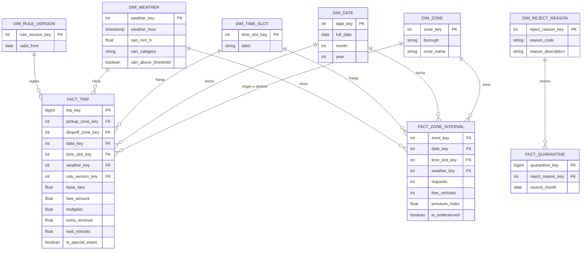

# Modelo Analítico Dimensional (Capa Gold)

El modelo dimensional implementa un esquema en constelación de hechos optimizado para responder a las preguntas estratégicas de negocio en **Power BI** a través de **Amazon Athena**.

---

## 1. Tablas de Hechos (Facts)

| Entidad                | Granularidad                     | Qué mide                                                                                          | Pregunta de negocio que responde                                                                                                        |
| ---------------------- | -------------------------------- | ------------------------------------------------------------------------------------------------- | --------------------------------------------------------------------------------------------------------------------------------------- |
| **FACT_TRIP**          | Un viaje válido                  | Tarifa base, tarifa cobrada, multiplicador, ingreso adicional, espera, bandera de evento especial | Ingreso adicional frente a la tarifa fija; % de viajes con multiplicador > 1 por distrito y mes; efecto de la lluvia en tarifa y espera |
| **FACT_ZONE_INTERVAL** | Una zona por intervalo de tiempo | Solicitudes, vehículos libres, presión, bandera de zona desatendida                               | Demanda y oferta por zona y franja; zonas desatendidas (RN-08); efecto de la lluvia en la demanda                                       |
| **FACT_QUARANTINE**    | Un viaje enviado a cuarentena    | Cantidad de viajes rechazados, por motivo y mes de origen                                         | % de viajes enviados a cuarentena y por qué motivos                                                                                     |

---

## 2. Dimensiones Compartidas

| Entidad               | Por qué existe                                                                                                                          | Se usa en                     |
| --------------------- | --------------------------------------------------------------------------------------------------------------------------------------- | ----------------------------- |
| **DIM_ZONE**          | Agrupar por zona y distrito. Con múltiples roles: origen y destino en `FACT_TRIP`                                                       | FACT_TRIP, FACT_ZONE_INTERVAL |
| **DIM_DATE**          | Filtrar por día, mes y año sin calcularlo en el tablero. La genera Spark                                                                | FACT_TRIP, FACT_ZONE_INTERVAL |
| **DIM_TIME_SLOT**     | Agrupar por franja horaria (base de RN-05). La genera Spark                                                                             | FACT_TRIP, FACT_ZONE_INTERVAL |
| **DIM_WEATHER**       | Clima hora por hora. Tiene valor exacto, categoría (`rain_category`) y bandera de umbral (`rain_above_threshold`, más de 2 mm/h)        | FACT_TRIP, FACT_ZONE_INTERVAL |
| **DIM_RULE_VERSION**  | Comparar resultados entre versiones de reglas (RF-08)                                                                                   | FACT_TRIP                     |
| **DIM_REJECT_REASON** | Catálogo de motivos de rechazo de RN-01: distancia inválida, tarifa negativa, duración excedida, zona inexistente y fechas incoherentes | FACT_QUARANTINE               |

## 3. Sobre `DIM_WEATHER`

La granularidad es **una fila por hora**, porque F3 trae el clima por hora. Cada viaje o intervalo apunta a la fila de su hora. Los campos tienen tres formas del mismo dato:

- `rain_mm_h`: valor exacto, para promedios y correlaciones.
- `rain_category`: rangos para filtros y gráficos.
- `rain_above_threshold`: conecta con RN-04 (la regla solo actúa si llueve más de 2 mm/h).

Los cortes de `rain_category` no vienen en el enunciado; el equipo debe definirlos.

## 4. Correspondencia entre modelos

|Operacional|Analítico|Cómo llega|Nota|
|---|---|---|---|
|`ZONE`|`DIM_ZONE`|Spark desde F2|Ambos salen del mismo catálogo F2|
|`TARIFF_RULE_VERSION`|`DIM_RULE_VERSION`|Spark||
|`TRIP_REQUEST` y `FARE_AUDIT`|`FACT_TRIP`|Airflow extrae a diario; Spark integra|Para viajes históricos de F1, `FACT_TRIP` se construye desde F1|
|`ZONE_STATE_HISTORY`|`FACT_ZONE_INTERVAL`|Airflow extrae; Spark integra||
|`SPECIAL_EVENT`|`is_special_event` en `FACT_TRIP`|Spark enriquece|Para el histórico, los eventos salen de F7 en Bronze|
|Capa Quarantine (S3)|`FACT_QUARANTINE` y `DIM_REJECT_REASON`|Spark|Quarantine es una capa del lake, no una tabla de PostgreSQL|
|Clima histórico F3 (Bronze)|`DIM_WEATHER`|Spark|**No sale de `WEATHER_CURRENT`**, que solo guarda el valor actual|
|`DRIVER`, `VEHICLE`, `VEHICLE_STATE`, `LICENSE`, `SANCTION`, `ZONE_STATE`, `WEATHER_CURRENT`|Sin equivalente||Son solo operacionales: sirven para operar en vivo|

Las dimensiones `DIM_DATE` y `DIM_TIME_SLOT` no vienen de ninguna entidad: Spark las genera.