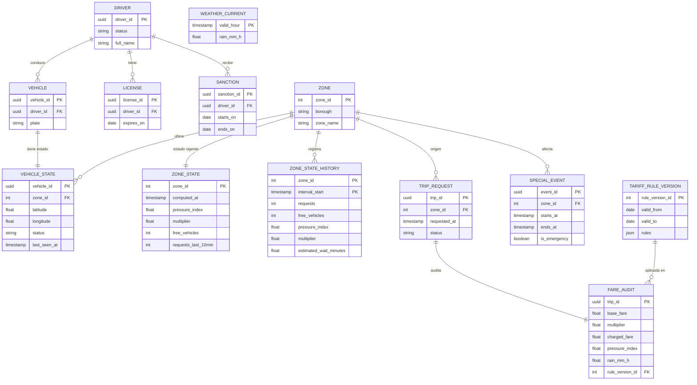

# Modelo Entidad-Relación Operacional (PostgreSQL)

El esquema operacional contiene **13 entidades relacionales** gestionadas mediante migraciones con Alembic.

---

## Detalle de Entidades
| Entidad                   | Qué es                                     | Por qué existe                                                                                                                                        | Escribe                     | Lee                                          |
| ------------------------- | ------------------------------------------ | ----------------------------------------------------------------------------------------------------------------------------------------------------- | --------------------------- | -------------------------------------------- |
| **DRIVER**                | Conductor registrado                       | Su estado (activo o suspendido) define si cuenta como oferta (RN-09)                                                                                  | seed (F6)                   | pressure-worker                              |
| **VEHICLE**               | Vehículo de un conductor                   | La telemetría F4 trae el id del vehículo; esta tabla permite llegar al conductor                                                                      | seed (F6)                   | pressure-worker                              |
| **VEHICLE_STATE**  | Última posición y estado de cada vehículo  | Permite marcar fuera de servicio al que no reporta en 2 minutos (RN-10) y contar los libres por zona                                                  | pressure-worker             | pressure-worker                              |
| **LICENSE**               | Licencia con vigencia                      | Una licencia vencida saca al conductor de la oferta (CA-06)                                                                                           | seed (F6)                   | pressure-worker                              |
| **SANCTION**              | Sanción con fechas de inicio y fin         | Mientras esté vigente, el conductor no cuenta como oferta                                                                                             | seed (F6)                   | pressure-worker                              |
| **ZONE**                  | Catálogo de las 265 zonas                  | Valida la zona de cada viaje y solicitud (RN-01)                                                                                                      | carga de F2                 | worker, API                                  |
| **ZONE_STATE**            | Valor vigente por zona (una fila por zona) | La API lo lee por clave en cada consulta; `computed_at` detecta un dato obsoleto (RNF-02, RNF-04)                                                     | pressure-worker             | API                                          |
| **ZONE_STATE_HISTORY**    | Una fila por zona e intervalo              | Es la historia que alimenta `FACT_ZONE_INTERVAL`. Existe aparte para que `ZONE_STATE` siga siendo una lectura por clave rápida                        | pressure-worker             | Airflow (extracción)                         |
| **WEATHER_CURRENT**       | Lluvia actual de la ciudad por hora        | Evita llamar a una API externa en cada cálculo (RN-04)                                                                                                | DAG horario de Airflow (F3) | pressure-worker                              |
| **TARIFF_RULE_VERSION**   | Reglas de tarifa con su vigencia           | Permite saber qué reglas aplicaban en una fecha y recalcular un periodo (RF-08)                                                                       | carga de reglas             | worker, API                                  |
| **TRIP_REQUEST**          | Solicitud de viaje                         | Su `requested_at` fija el multiplicador que se cobra, aunque la asignación ocurra después (RN-07)                                                     | API                         | API, auditoría                               |
| **FARE_AUDIT**            | Cómo se calculó cada tarifa                | Registro inmutable para reconstruirla: base, multiplicador, tarifa cobrada, presión, lluvia y versión de reglas. Se conserva 24 meses (RN-12, RNF-05) | API                         | API (auditoría), Airflow (extracción diaria) |
| **SPECIAL_EVENT**         | Evento o emergencia por zona               | Con `is_emergency` el multiplicador se fuerza a 1,0 (RN-06)                                                                                           | carga de F7                 | pressure-worker                              |

### 1. Catálogos y Reglas
* **`zone`**: Catálogo de las 265 zonas oficiales de taxi de Nueva York (F2).
  * `zone_id` (INT, PK), `borough` (TEXT), `zone_name` (TEXT).
* **`tariff_rule_version`**: Reglas de cálculo tarifario con vigencia temporal.
  * `rule_version_id` (INT, PK), `valid_from` (DATE), `valid_to` (DATE, NULL = vigente), `rules` (JSONB).
* **`weather_current`**: Precipitación pluvial por hora (F3).
  * `valid_hour` (TIMESTAMPTZ, PK), `rain_mm_h` (FLOAT mayor o igual a 0).

### 2. Flota y Conductores
* **`driver`**: Conductores afiliados (F6).
  * `driver_id` (UUID, PK), `status` (`'active'`, `'inactive'`, `'suspended'`), `full_name` (TEXT).
* **`vehicle`**: Vehículos asignados a conductores.
  * `vehicle_id` (UUID, PK), `driver_id` (UUID, FK), `plate` (TEXT, UNIQUE).
* **`license`**: Licencias de conducción para control de vigencia.
  * `license_id` (UUID, PK), `driver_id` (UUID, FK), `expires_on` (DATE).
* **`sanction`**: Medidas disciplinarias con vigencia.
  * `sanction_id` (UUID, PK), `driver_id` (UUID, FK), `starts_on` (DATE), `ends_on` (DATE).

### 3. Estado en Tiempo Real
* **`vehicle_state`**: Última posición conocida y estado del vehículo.
  * `vehicle_id` (UUID, PK, FK), `zone_id` (INT, FK), `latitude` (FLOAT), `longitude` (FLOAT), `status` (TEXT), `last_seen_at` (TIMESTAMPTZ).
* **`zone_state`**: Estado instantáneo calculado por zona (lectura de la API).
  * `zone_id` (INT, PK, FK), `computed_at` (TIMESTAMPTZ), `pressure_index` (FLOAT mayor o igual a 0), `multiplier` (NUMERIC(3,2) entre 1.0 y 2.0), `free_vehicles` (INT), `requests_last_10min` (INT).
* **`zone_state_history`**: Serie temporal de presión y espera por zona para analítica.
  * PK compuesta `(zone_id, interval_start)`.
* **`special_event`**: Eventos masivos y emergencias que congelan el multiplicador.
  * `event_id` (UUID, PK), `zone_id` (INT, FK), `starts_at` (TIMESTAMPTZ), `ends_at` (TIMESTAMPTZ), `is_emergency` (BOOLEAN).

### 4. Transaccional y Auditoría
* **`trip_request`**: Solicitud de viaje iniciada por un usuario.
  * `trip_id` (UUID, PK), `zone_id` (INT, FK), `requested_at` (TIMESTAMPTZ), `status` (`'created'`, `'cancelled'`, `'assigned'`).
* **`fare_audit`**: Registro inmutable de tarificación (RN-12).
  * `trip_id` (UUID, PK, FK), `base_fare` (NUMERIC(10,2)), `multiplier` (NUMERIC(3,2)), `charged_fare` (NUMERIC(10,2)), `pressure_index` (FLOAT), `rain_mm_h` (FLOAT), `rule_version_id` (INT, FK), `degraded` (BOOLEAN).
