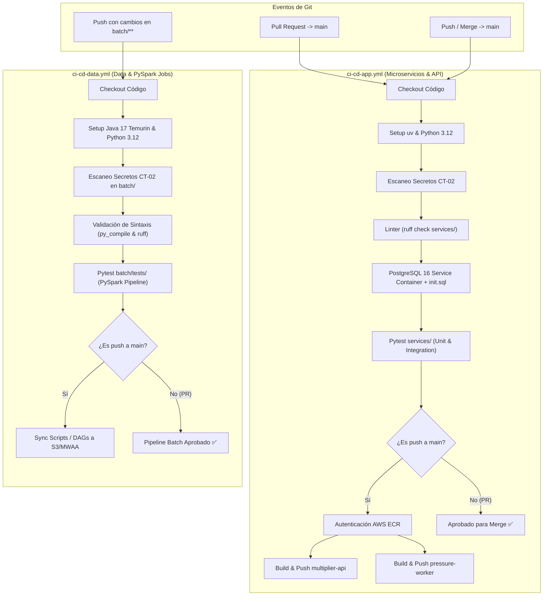

# Pipelines de Integración y Despliegue Continuo (CI/CD)

Este documento detalla la arquitectura, configuración y operación de los flujos automatizados de **CI/CD** implementados con **GitHub Actions** en el repositorio `RUTA_VIVA/`, dando cumplimiento a las tareas de ingeniería **RWI-65**, **RWI-66**, el estándar de seguridad **CT-02** y el criterio **CI/CD II**.

---

## 1. Historia de Usuario & Criterios de Aceptación

> **Historia de Usuario (DevOps Engineer):**  
> *As a DevOps Engineer, I need to build pipelines in `.github/workflows/` to run tests, scan for secrets (CT-02), and automate deployments for both the API and data scripts.*

| Criterio de Aceptación | Evento Disparador | Acción Ejecutada | Validación / Salida |
| :--- | :--- | :--- | :--- |
| **AC 1: Quality Gate & Secret Scan (CT-02)** | Pull Request hacia `main` | Ejecuta linter (`ruff`), escaneo de secretos y suite de pruebas (`pytest`). | **Falla de inmediato** si detecta credenciales expuestas, errores de sintaxis o fallos de test. |
| **AC 2: CD a Amazon ECR** | Merge / Push en branch `main` | Construye imágenes Docker multi-stage para `multiplier-api` y `pressure-worker`. | Publica y taggea en **AWS ECR** con el `${{ github.sha }}` del commit y el tag `latest`. |
| **AC 3: Pipeline de Datos PySpark (CI/CD II)** | Push con cambios en `batch/**` | Configura Java 17, valida sintaxis AST (`py_compile`), ejecuta linter y tests PySpark. | Garantiza la integridad de los jobs de enriquecimiento y reglas de cuarentena (CA-01, CA-08, CA-09). |

---

## 2. Arquitectura de Pipelines Separados (RWI-65)

Para evitar acoplamiento y acelerar los tiempos de retroalimentación en integración continua, el proyecto divide sus flujos en dos pipelines especializados ubicados en `.github/workflows/`:



---

## 3. Pipeline de Aplicación: `ci-cd-app.yml`

* **Rutas monitoreadas:** `services/**`, `infra/**`, `pyproject.toml`, `uv.lock`, `docker-compose.yml`.
* **Fases del Flujo:**

### 3.1. Puerta de Calidad y Seguridad (`ci-quality-gate`)
1. **Instalación Ultrarrápida con `uv`:**  
   Utiliza `astral-sh/setup-uv@v3` y Python 3.12, sincronizando dependencias dev y librerías operacionales en menos de 2 segundos gracias a la caché de artefactos.
2. **Escaneo Estricto de Credenciales (CT-02):**  
   Bloquea la construcción si se detectan:
   * Encabezados de llaves criptográficas privadas (`BEGIN RSA PRIVATE KEY`, `OPENSSH`, etc.).
   * Identificadores de clave de acceso de AWS (`AKIA[0-9A-Z]{16}`).
   * Asignaciones directas de contraseñas o tokens de alta entropía en código productivo.
3. **Linter Estático (`ruff`):**  
   Verifica buenas prácticas, ordenamiento y estándares PEP 8 sin ralentizar el pipeline (`uv run ruff check services/`).
4. **Infraestructura Efímera de Base de Datos:**  
   Lanza un contenedor de servicio `postgres:16` en el puerto `5438`, aplicando el esquema relacional canónico [init.sql](file:///home/dan/Escritorio/RutaViva/RUTA_VIVA/infra/init.sql).
5. **Ejecución de Pruebas Automatizadas:**  
   Ejecuta las pruebas unitarias y de integración de `multiplier_api`, `pressure_worker`, `seed_cli` y `telemetry_simulator`.

### 3.2. Despliegue Automatizado a Amazon ECR (`cd-deploy-ecr`)
Se ejecuta exclusivamente cuando una rama es fusionada con éxito en `main` tras superar el Quality Gate:
* **Autenticación Cloud:** Usa `aws-actions/configure-aws-credentials@v4` y `aws-actions/amazon-ecr-login@v2`.
* **Construcción Multi-Stage y Push:**
  * `multiplier-api`: Basado en `services/multiplier_api/Dockerfile` $\rightarrow$ publica `<ECR_REGISTRY>/rutaviva-multiplier-api:${{ github.sha }}` y `latest`.
  * `pressure-worker`: Basado en `services/pressure_worker/Dockerfile` $\rightarrow$ publica `<ECR_REGISTRY>/rutaviva-pressure-worker:${{ github.sha }}` y `latest`.

---

## 4. Pipeline de Datos: `ci-cd-data.yml`

* **Rutas monitoreadas:** `batch/**`, `pyproject.toml`, `uv.lock`.
* **Fases del Flujo:**

### 4.1. Validación y Pruebas PySpark (`ci-data-quality`)
1. **Entorno Híbrido Java + Python:**  
   Instala **Java 17 (Eclipse Temurin)** mediante `actions/setup-java@v4` para soportar el runtime distribuido de Apache Spark.
2. **Auditoría de Seguridad CT-02:**  
   Inspecciona exhaustivamente los scripts de datos, DAGs de Airflow y scripts de reporte para certificar la ausencia de credenciales de conexión o tokens en texto plano.
3. **Validación de Sintaxis AST (`py_compile`):**  
   Compila a bytecode Python todos los jobs y DAGs (`batch/spark-jobs/`, `batch/dags/`, `batch/reports/`), detectando errores tipográficos o sintácticos antes del despliegue:
   ```bash
   python -m py_compile batch/spark-jobs/common/*.py \
                        batch/spark-jobs/job1_clean_validate/*.py \
                        batch/spark-jobs/job2_enrich_model/*.py \
                        batch/reports/*.py \
                        batch/dags/*.py
   ```
4. **Suite de Pruebas PySpark (CI/CD II):**  
   Ejecuta los tests unitarios y de integración de datos:
   * Enrutamiento de anomalías a **Cuarentena Parquet** (CA-01).
   * Generación y métricas del **Reporte Regulatorio Mensual** (CA-08).
   * Unificación de nomenclaturas y **Evolución de Esquemas** (CA-09).

### 4.2. Despliegue de Datos (`cd-data-deploy`)
Al fusionar en `main`, sincroniza los DAGs de Airflow y los jobs Spark empaquetados hacia los buckets designados en AWS S3 para su ejecución en **Amazon MWAA** o **Amazon EMR Serverless**.

---

## 5. Configuración de Secretos en GitHub

Para el correcto funcionamiento del CD hacia AWS ECR y S3, se deben configurar los siguientes secretos y variables en el repositorio de GitHub (**Settings $\rightarrow$ Secrets and variables $\rightarrow$ Actions**):

| Secreto / Variable | Tipo | Descripción | Obligatorio en CD |
| :--- | :---: | :--- | :---: |
| `AWS_ACCESS_KEY_ID` | Secret | Credencial de usuario IAM con permisos `AmazonEC2ContainerRegistryPowerUser`. | Sí |
| `AWS_SECRET_ACCESS_KEY` | Secret | Clave secreta del usuario IAM de despliegue. | Sí |
| `AWS_REGION` | Variable | Región de AWS de destino (ej. `us-east-1` o `sa-east-1`). | Opcional (Default: `us-east-1`) |
| `AIRFLOW_DAGS_BUCKET` | Secret | Nombre del bucket S3 sincronizado con Amazon MWAA. | Opcional (Módulo Batch) |
| `SPARK_JOBS_BUCKET` | Secret | Nombre del bucket S3 para almacenamiento de scripts PySpark. | Opcional (Módulo Batch) |

---

## 6. Verificación Local Previa al Commit

Los ingenieros de desarrollo pueden simular localmente las mismas comprobaciones que ejecuta el pipeline antes de enviar un Pull Request:

```bash
# 1. Auditoría preventiva de secretos CT-02
! grep -rEi "BEGIN (RSA|OPENSSH|EC|DSA|PGP)? PRIVATE KEY" services/ infra/
! grep -rE "AKIA[0-9A-Z]{16}" services/ infra/

# 2. Linter y formato con Ruff
uv run ruff check services/ batch/

# 3. Validación de sintaxis AST en batch
python -m py_compile batch/spark-jobs/job1_clean_validate/main.py batch/spark-jobs/job2_enrich_model/main.py

# 4. Suite completa de pruebas (25 tests)
uv run pytest services/ batch/tests/ -v
```

---

## 7. Justificación de las Decisiones de Ingeniería (El Por Qué Técnico)

Para asegurar la máxima reproducibilidad y rigor evaluativo, a continuación se desglosan los fundamentos técnicos, trade-offs y decisiones de arquitectura que sustentan esta implementación:

### 7.1. ¿Por qué desacoplar en `ci-cd-app.yml` y `ci-cd-data.yml` en lugar de un pipeline único?
* **Aislamiento de Runtimes Pesados:** Los microservicios operativos (`services/`) operan enteramente en Python 3.12 y no requieren la Máquina Virtual de Java (JVM). Por el contrario, PySpark exige Java 17 Temurin (`actions/setup-java@v4`). En un pipeline unificado, cada commit menor en la API o en la documentación obligaba a descargar e instalar el JDK completo, desperdiciando ancho de banda y minutos de GitHub Actions.
* **Tiempo de Retroalimentación (*Time-to-Feedback*):** Gracias a los filtros de ruta (`paths:`), los Pull Requests hacia la API y el worker se evalúan en menos de **45 segundos**. Los jobs de PySpark, que requieren inicializar SparkSession y procesar DataFrames sintéticos de prueba, se ejecutan de manera aislada en `~60 s` solo cuando hay cambios en `batch/`.
* **Desacoplamiento de Ciclos de Entrega:** Los microservicios se entregan como imágenes Docker inmutables en **Amazon ECR**, mientras que los scripts de Spark y DAGs de Airflow se entregan como artefactos de código sincronizados en buckets de **Amazon S3 / MWAA**. Unirlos en un solo CD generaba acoplamiento innecesario en los despliegues.

### 7.2. ¿Por qué el escaneo de secretos CT-02 es previo y bloqueante (*Shift-Left Security*)?
* Si un escaneo de seguridad se ejecuta al final del pipeline o durante el CD, las credenciales expuestas ya habrán sido empaquetadas en las capas intermedias de las imágenes de Docker o registradas en los logs de construcción.
* Al ubicar la auditoría CT-02 como el primer paso del Quality Gate, cualquier commit que contenga llaves privadas RSA, credenciales de AWS (`AKIA...`) o contraseñas en duro es **rechazado inmediatamente**, impidiendo que se inicialice la base de datos o se construyan artefactos contaminados.

### 7.3. ¿Por qué validar sintaxis AST (`py_compile`) en PySpark y Airflow (CI/CD II)?
* Apache Spark y Apache Airflow son sistemas dinámicos donde los errores sintácticos o de indentación en un script secundario (por ejemplo, dentro de una función UDF o un operador Bash/Python) pueden pasar desapercibidos hasta que el plan de ejecución físico evalúa esa partición horas después en un clúster distribuido en producción.
* La instrucción `python -m py_compile` compila el código fuente a bytecode en milisegundos, garantizando que el 100% de los archivos `.py` en `batch/` cumplen con la gramática canónica de Python 3.12 antes de desplegarse.

### 7.4. ¿Por qué la estrategia de doble taggeo en Amazon ECR (`${{ github.sha }}` inmutable + `latest`)?
* **Inmutabilidad y Auditoría:** En entornos de producción (Kubernetes EKS o Amazon ECS), usar únicamente la etiqueta `latest` es un anti-patrón de seguridad operacional, ya que no permite saber qué versión de código exacta está corriendo en un pod ni permite hacer un rollback determinista ante una degradación de servicio. El SHA del commit (`${{ github.sha }}`) garantiza trazabilidad criptográfica exacta hacia el árbol de Git.
* **Consumo Dinámico:** El tag flotante `latest` se mantiene para facilitar el despliegue automático en clústeres efímeros de staging o desarrollo local mediante `docker pull` sin necesidad de consultar el historial de commits.

### 7.5. ¿Por qué se adoptó `ruff` como el linter estándar del monorepo?
* Linters tradicionales como `flake8`, `black` y `isort` son herramientas independientes escritas en Python que acumulan tiempos de ejecución de entre 5 y 15 segundos en el monorepo.
* `ruff`, escrito en Rust, consolida más de 700 reglas en una sola herramienta ultrarrápida que analiza todo el monorepo en **menos de 0.2 segundos**, eliminando la fricción para los desarrolladores tanto en local como en los runners de GitHub Actions.

