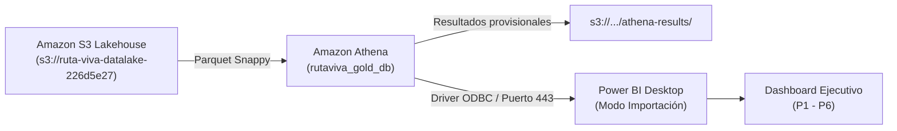

# Conexión de Power BI Desktop a Amazon Athena

Este documento técnico detalla la arquitectura de integración entre el **Data Lake S3**, el motor serverless **Amazon Athena** y **Power BI Desktop**, justificando el rol de cada componente y explicando la resolución de las 6 preguntas de negocio (**P1 - P6**).

---

## 1. Arquitectura de Integración Analítica

### Justificación de Componentes

1. **Amazon Athena como pasarela sobre S3:**
   - Evita saturar la base de datos operacional PostgreSQL (`rutaviva_db`).
   - Lee nativamente archivos comprimidos en Apache Parquet particionados por año y mes (`year=2026/month=10`).
   - Modelo de cobro **serverless**: solo se factura por datos leídos ($5.00/TB), reduciendo el costo mensual a centavos.
2. **Modo Importar en Power BI:**
   - Permite empaquetar los 5,000 registros de la capa Gold dentro del archivo `.pbix`.
   - Garantiza interactividad instantánea sin latencia de red.
   - Posibilita apagar la infraestructura cloud (`terraform destroy`) manteniendo el reporte 100% navegable.

---

## 2. Parámetros de Conexión

* **Conector:** Amazon Athena
* **Servidor (Server):** `athena.us-east-1.amazonaws.com`
* **Puerto (Port):** `443`
* **Directorio provisional (S3 Staging Directory):** `s3://ruta-viva-datalake-226d5e27/athena-results/`
* **Catálogo de metadatos:** `AwsDataCatalog`
* **Base de datos:** `rutaviva_gold_db`
* **Modo de almacenamiento:** `Import`

---

## 3. Tablas Disponibles en `rutaviva_gold_db`

### `fact_trips` (Capa Gold)
Tabla de hechos consolidada con métricas calculadas:
* `trip_id`: Identificador único del viaje.
* `pickup_zone_id` / `pickup_zone_name`: Zona TLC de recogida.
* `pickup_borough`: Distrito metropolitano (Manhattan, Queens, Brooklyn, Bronx, Staten Island).
* `pickup_hour`: Hora del día (0 - 23).
* `trip_distance`: Distancia en millas.
* `duration_minutes`: Duración del viaje en minutos.
* `base_fare`: Tarifa regulada de partida ($).
* `surge_multiplier`: Multiplicador dinámico aplicado (1.00x - 2.00x).
* `charged_fare`: Tarifa total cobrada al pasajero ($).
* `dynamic_revenue_delta`: Ganancia adicional generada por el multiplicador (`charged_fare - base_fare`).
* `precipitation_mm`: Lluvia registrada en la hora del viaje.
* `is_rush_hour`: Booleano de hora pico (7-9 AM o 5-7 PM).
* `is_surge`: Booleano que indica si el multiplicador superó 1.00x.

### `quarantine_trips` (Capa Cuarentena)
Tabla de auditoría de calidad de datos con viajes descartados y motivo de rechazo:
* `quarantine_id`: Identificador de auditoría.
* `rejection_reason`: Motivo de rechazo (`tarifa_negativa_o_invalida`, `distancia_invalida_o_cero`, `duracion_excesiva`, `zona_fuera_catalogo`).
* `recorded_at`: Marca temporal de descarte.

### `dim_zone` (Dimensión de Zonas)
Catálogo oficial de las zonas de taxi de la ciudad de Nueva York.

---

## 4. Visuales de Negocio Obligatorios

| Pregunta | Indicador | Visual Recomendado | Campos Principales |
|---|---|---|---|
| **P1** | Demanda por zona y hora pico | Gráfico de columnas apiladas | X: `pickup_hour`, Y: Recuento `trip_id`, Leyenda: `pickup_borough` |
| **P2** | Zonas críticas con alto multiplicador | Tabla con formato condicional | Filas: `pickup_zone_name`, Valores: Promedio `surge_multiplier`, Promedio `duration_minutes` |
| **P3** | Correlación lluvia vs. multiplicador | Gráfico de dispersión con tendencia | X: `precipitation_mm`, Y: Promedio `surge_multiplier` |
| **P4** | % de viajes con tarifa dinámica | Gráfico de anillos + Tarjeta KPI | Leyenda: `is_surge`, Valores: Recuento `trip_id` |
| **P5** | Ingreso incremental capturado | Tarjeta de métrica + Gráfico cascada | Medida: `SUM(dynamic_revenue_delta)` |
| **P6** | Motivos de rechazo en Cuarentena | Gráfico de barras horizontales | Eje Y: `rejection_reason`, Eje X: Recuento `quarantine_id` |
