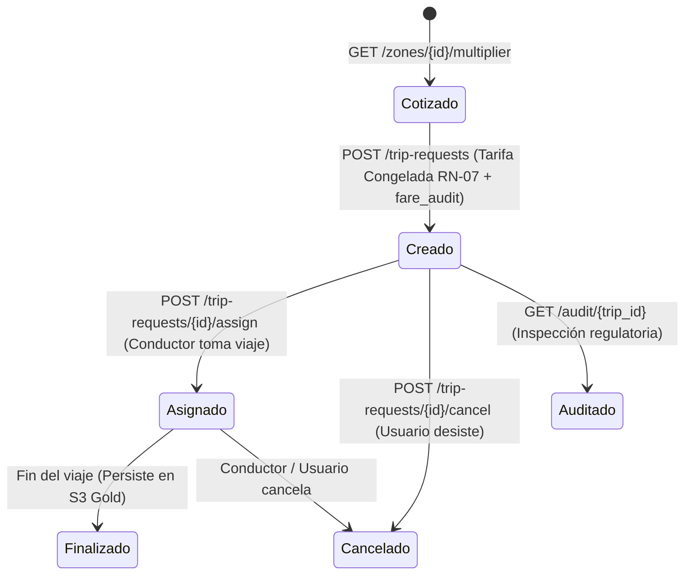

# Glosario Técnico y Arquitectura para Desarrolladores

Referencia exhaustiva de conceptos, servicios, contenedores, fórmulas, roles y acciones de la plataforma **RutaViva**. Diseñada para acelerar el *onboarding* técnico y garantizar coherencia conceptual entre equipos de frontend, backend, datos y DevOps.

---

## 1. Glosario de Microservicios y Contenedores Docker

| Contenedor / Servicio | Directorio | Tecnología | Puerto | Responsabilidad Técnica |
|---|---|---|---|---|
| **`rutaviva_postgres`** | `infra/` | PostgreSQL 16 | `5432` / `5438` | Base de datos relacional operacional (OLTP). Contiene las tablas del MER operacional (`zone`, `driver`, `vehicle_state`, `zone_state`, `trip_request`, `fare_audit`, etc.). |
| **`rabbitmq-telemetria`** | `infra/` | RabbitMQ 3.12 (Alpine) | `5672` (AMQP), `15672` (Web) | Broker de mensajería asíncrona orientado a eventos. Administra el exchange de tópico `telemetria.viajes` y la cola durable `telemetria.vehiculos`. |
| **`rutaviva_multiplier_api`** | `services/multiplier_api/` | FastAPI, SQLAlchemy 2.0, Uvicorn | `8000` | API REST central de cara al usuario. Expone la cotización de tarifas, creación de viajes con congelamiento (**RN-07**), asignación y auditoría inmutable (**RNF-06**). |
| **`rutaviva_pressure_worker`** | `services/pressure_worker/` | Python 3.12, `aio-pika`, SQLAlchemy | - | Trabajador asíncrono en segundo plano. Consume telemetría masiva de RabbitMQ, aplica filtros de conductores suspendidos (**RN-09**) y calcula el multiplicador en `zone_state`. |
| **`rutaviva_telemetry_simulator`** | `services/telemetry_simulator/` | Python 3.12, GeoPandas, Shapely | - | Generador cinemático de movimiento GPS para ~8,000 vehículos. Emite lotes de 500 mensajes cada 15 segundos con inyección controlada de defectos (**HU-02**). |
| **`rutaviva_weather_worker`** | `services/weather-api/` | Python 3.12, Open-Meteo, SQLAlchemy | - | Ingestor horario de clima. Consulta la precipitación pluvial de la ciudad y la almacena de forma idempotente en `weather_current` (**Fuente F3**). |
| **`rutaviva_request_simulator`** | `services/request_simulator/` | Python 3.12, `httpx`, Asyncio | - | Motor de simulación de demanda. Emula solicitudes de viaje concurrentes para pruebas de estrés y validación del comportamiento de tarifas dinámicas (**CA-10**). |
| **`seed_cli`** | `services/seed_cli/` | Python 3.12, Faker, GeoPandas | - | Herramienta CLI de población de datos iniciales. Carga las 265 zonas desde `taxi_zones.shp` y genera conductores, licencias y sanciones deterministas (UUIDv5). |

---

## 2. Glosario de Redes y Volúmenes Docker

* **`rutaviva_network`**: Red tipo *bridge* aislada de Docker que interconecta todos los microservicios sin exponer puertos innecesarios hacia el exterior.
* **`pg_data`**: Volumen persistente donde PostgreSQL almacena físicamente las tablas, índices y catálogos en el disco del host.
* **`rabbitmq_data`**: Volumen persistente que almacena los metadatos de exchanges, colas y mensajes durables no consumidos de RabbitMQ.
* **Montaje de Shapefiles (`./services/seed_cli/.../shapefiles:/app/data/shapefiles:ro`)**: Montaje de sólo lectura que permite a los simuladores consultar las geometrías de las 265 zonas sin duplicar archivos binarios pesados dentro de las imágenes Docker.

---

## 3. Glosario de Roles del Sistema

* **`Pasajero (passenger)`**: Usuario final o aplicación cliente que cotiza un viaje y crea una solicitud de movilidad en una zona determinada.
* **`Conductor (driver)`**: Operador del taxi. Solo se considera oferta disponible si su estado es `available`, su última telemetría es menor a 120s, su licencia está vigente y no tiene sanciones activas (**RN-09**).
* **`Despachador / Sistema de Asignación (dispatcher)`**: Componente que vincula una solicitud de viaje creada con un vehículo específico disponible en la zona.
* **`Auditor (auditor)`**: Rol administrativo y legal (AMT / Entidades de Control) con privilegios para consultar la reconstrucción exacta e inmutable de cualquier tarifa cobrada mediante cabeceras de autorización (**RNF-06**).
* **`Administrador (admin)`**: Superusuario con facultades para parametrizar las reglas de negocio, consultar métricas globales y publicar nuevas versiones tarifarias en `tariff_rule_version`.

---

## 4. Glosario de Acciones y Ciclo de Vida del Viaje

* **`quote` (Cotizar)**: Operación de solo lectura en memoria donde la API consulta el multiplicador actual de la zona y estima el precio preliminar para mostrar en la interfaz del pasajero.
* **`trip-request` (Crear Solicitud)**: Transacción ACID donde se crea el registro del viaje con estado `created`, **se congela irrevocablemente el multiplicador cobrado** y se escribe la fila histórica en `fare_audit`.
* **`assign` (Asignar)**: Transición de estado a `assigned` cuando un taxi libre acepta la carrera. La tarifa final **no cambia**, protegiendo al usuario ante subidas posteriores.
* **`cancel` (Cancelar)**: Transición de estado a `cancelled`. Libera al conductor y descarta la solicitud.
* **`audit` (Auditar)**: Reconstrucción forense del cálculo tarifario para verificar qué factores intervinieron (presión, lluvia, versión de reglas, emergencia).

---

## 5. Glosario de Variables y Fórmulas Matemáticas

* **`base_fare` (Tarifa Base)**: Tarifa mínima fija calculada según **RN-01**:
  `Base = $1.50 + ($0.35 * km) + ($0.15 * min)`
* **`pressure_index` (`P`)**: Índice de presión por desbalance de oferta y demanda en una zona (**RN-02**):
  `P = Demanda / max(Oferta Libre, 1)`
* **`free_vehicles` (`O`, Oferta Libre)**: Número de taxis dentro del polígono de la zona que cumplen simultáneamente:
  1. `status == 'available'`.
  2. `last_seen_at >= now() - 120 segundos` (**RN-10**).
  3. Conductor no suspendido (`driver.status != 'suspended'`) (**RN-09**).
  4. Licencia de conducir vigente (`license.expires_on >= today()`).
  5. Sin sanciones administrativas vigentes (`sanction.ends_on < today()`).
* **`demand_requests` (`D`, Demanda Reciente)**: Cantidad de solicitudes registradas en la tabla `trip_request` para esa zona en los últimos 10 minutos (**RN-02**).
* **`dynamic_multiplier` (`M`)**: Factor multiplicador aplicado sobre la tarifa base. Cumple estrictamente con los límites legales (**RN-05**):
  `1.0 <= M <= 2.0` (con tope de `1.5` en horario nocturno entre las 22:00 y las 05:00).
* **`rain_mm_h` (Precipitación Pluvial)**: Tasa horaria de lluvia en milímetros por hora. Si supera `2.0 mm/h`, suma un escalón tarifario adicional (**RN-04**).
* **`is_degraded` (Bandera de Degradación)**: Booleano que indica si el multiplicador provino del cálculo de telemetría viva (`false`) o si se aplicó la política de emergencia `1.0x` por indisponibilidad o vejez de datos (`true`) (**RNF-04**).
* **`rule_version_id`**: Identificador inmutable de la regla tarifaria vigente (clave foránea hacia `tariff_rule_version`).

---

## 6. Glosario de Mecánicas de Simulación y Defectos

* **`Tick`**: Intervalo discreto de avance del simulador (15 segundos). En cada tick, los 8,000 vehículos recalculan su cinemática (rumbo y velocidad entre 5 y 60 km/h).
* **`Vehículo Silencioso` (`SILENT_VEHICLES_PCT = 5.0%`)**: Anomalía inyectada donde el 5% de la flota deja de emitir telemetría para comprobar que el `pressure_worker` los expulse de la oferta activa tras 120 segundos (**HU-02 / RN-10**).
* **`Fuera de la Ciudad` (`OUT_OF_CITY_PCT = 3.0%`)**: Anomalía inyectada donde el 3% de la flota reporta coordenadas en el océano o fuera del mapa metropolitano para verificar que el indexador espacial R-Tree los descarte de la zona (**HU-02**).
* **`Burst Mode` (Modo Ráfaga)**: Capacidad de `request_simulator` de concentrar docenas de peticiones HTTP en pocos segundos sobre una zona para forzar el incremento del multiplicador (**CA-10**).
