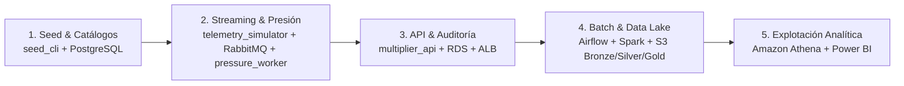
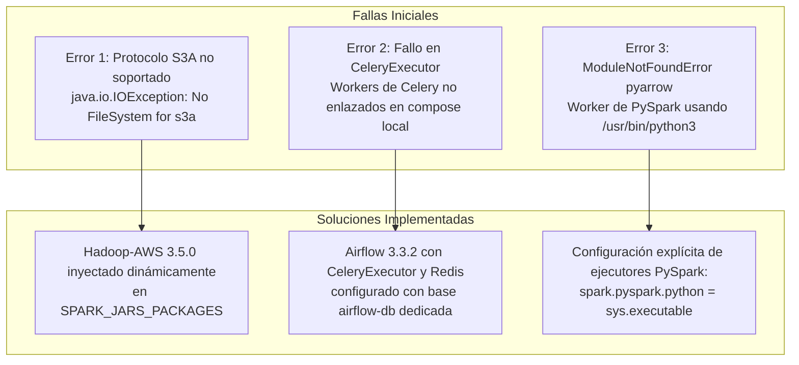

# Guía Maestra de Preguntas, Respuestas y Sustentación Técnica

> **Proyecto**: RutaViva Mobility  
> **Destinatarios**: Equipo de Ingeniería de Datos, Desarrolladores, Arquitectos Cloud y Evaluadores  
> **Propósito**: Consolidar en un solo documento de referencia todas las preguntas operacionales, de arquitectura, de diagnóstico y de defensa técnica formuladas durante el ciclo de vida del proyecto, con su justificación detallada y evidencia directa en el código e infraestructura.

---

## 📑 Tabla de Contenidos
1. [Pregunta 1: Flujo Óptimo Integral del Proyecto según Requerimientos](#1-flujo-óptimo-integral-del-proyecto-según-requerimientos)
2. [Pregunta 2: Matriz de Validación de Servicios (Dónde comprobar que todo funciona)](#2-matriz-de-validación-de-servicios-dónde-comprobar-que-todo-funciona)
3. [Pregunta 3: Diagnóstico del Simulador de Solicitudes en CloudWatch](#3-diagnóstico-del-simulador-de-solicitudes-en-cloudwatch)
4. [Pregunta 4: Protocolo de Pruebas de Estrés con `request_simulator` contra el ALB](#4-protocolo-de-pruebas-de-estrés-con-request_simulator-contra-el-alb)
5. [Pregunta 5: Causa Raíz y Solución Definitiva de las Fallas en los DAGs de Airflow](#5-causa-raíz-y-solución-definitiva-de-las-fallas-en-los-dags-de-airflow)
6. [Pregunta 6: Justificación Técnica de la Ingesta de Datos Históricos a AWS S3 vs. Entorno Local](#6-justificación-técnica-de-la-ingesta-de-datos-históricos-a-aws-s3-vs-entorno-local)
7. [Pregunta 7: Comparativa de Arquitectura: `docker-compose up -d` en AWS vs. Servicios Nativos](#7-comparativa-de-arquitectura-docker-compose-up--d-en-aws-vs-servicios-nativos)
8. [Pregunta 8: Banco de Preguntas Técnicas y Defensa de Criterios (ADRs y Jurado)](#8-banco-de-preguntas-técnicas-y-defensa-de-criterios-adrs-y-jurado)

---

## 1. Flujo Óptimo Integral del Proyecto según Requerimientos

El sistema **RutaViva Mobility** opera en 5 fases interconectadas que cubren desde el aprovisionamiento de datos iniciales hasta la reportería analítica final:



1. **Fase 1: Poblamiento y Catálogos (Seed & DB)**:
   * Aprovisionamiento de tablas en PostgreSQL 16 (`zone`, `driver`, `vehicle`, `tariff_rule_version`).
   * Carga de las 263 zonas del TLC con polígonos geométricos oficiales mediante `seed_cli`.
2. **Fase 2: Telemetría y Cálculo de Presión en Streaming**:
   * `telemetry_simulator` genera coordenadas GPS cada 15 segundos para 8,000 vehículos (~533 msg/s) hacia el exchange `telemetria.viajes` en RabbitMQ.
   * `pressure_worker` consume los eventos, actualiza el estado de la flota (`vehicle_state`) y calcula la presión de demanda por zona (`zone_state`) cada 30 segundos, consultando el clima en vivo de Open-Meteo (`weather_current`).
3. **Fase 3: Servicio de Tarifas Dinámicas y Auditoría**:
   * Pasajeros o simuladores (`request_simulator`) consultan tarifas vía `POST /trip-requests` a través del Application Load Balancer (ALB).
   * La API valida reglas de negocio (RN-01 a RN-07: tope nocturno 1.5, penalización por lluvia, congelamiento por emergencia).
   * Registra cada decisión de manera inmutable en `fare_audit` para auditoría regulatoria.
4. **Fase 4: Ingesta Batch y Data Lake Medallón**:
   * El DAG `rutaviva_monthly_pipeline` en Apache Airflow se ejecuta el día 2 de cada mes.
   * `check_data_readiness` valida la presencia de fuentes F1, F3, F7 y shapefiles.
   * `extract_operational_sources` extrae datos del mes anterior desde PostgreSQL.
   * `bronze_ingestion` sincroniza landing hacia `s3://.../bronze/` con verificación de metadatos.
   * `job1_clean_validate` procesa F1 en Parquet/CSV, filtra anomalías a `quarantine/` y escribe `silver/`.
   * `job2_enrich_model` enriquece con clima horario F3, eventos F7 e indexación espacial UDF, publicando las tablas `gold/`.
   * `generate_regulatory_report` y `publish_regulatory_report` compilan y publican el informe RN-11 en JSON y CSV.
5. **Fase 5: Analítica y Business Intelligence**:
   * Amazon Athena consulta directamente las tablas Gold en Parquet sobre S3.
   * Cuadros de mando en Power BI consumen Athena mediante driver ODBC para análisis de recaudación, oferta vs. demanda y eficiencia de flota.

---

## 2. Matriz de Validación de Servicios (Dónde comprobar que todo funciona)

| Componente | Qué Valida | Dónde Validar (Consola / URL / Comando) | Criterio de Éxito |
|---|---|---|---|
| **ALB & Multiplier API** | Respuestas HTTP y balanceo | `http://<ALB-DNS>/health` o `http://localhost:8000/health` | `HTTP 200 {"status": "ok"}` |
| **Documentación Swagger** | OpenAPI y endpoints | `http://<ALB-DNS>/docs` | Interfaz interactiva de FastAPI cargada |
| **RabbitMQ** | Colas de telemetría y throughput | Consola web puerto `15672` (`admin`/`admin1234`) | Cola `telemetria.vehiculos` activa con tráfico constante |
| **PostgreSQL / RDS** | Tablas operacionales y auditoría | `psql -h <HOST> -U admin -d rutaviva_db -c "\dt"` | 9 tablas presentes (`fare_audit`, `zone_state`, etc.) |
| **ECS Fargate Tasks** | Tareas en ejecución continua | Consola AWS ECS &rarr; Clúster `ruta-viva-cluster` | Tareas en estado `RUNNING` |
| **CloudWatch Logs** | Flujos de telemetría y API | `/ecs/ruta-viva/multiplier_api`, `/ecs/ruta-viva/pressure_worker` | Streams con eventos JSON recientes |
| **Data Lake S3** | Ingesta Medallón y reportes | `aws s3 ls s3://ruta-viva-datalake-226d5e27/ --recursive` | Carpetas `bronze/`, `silver/`, `quarantine/`, `gold/` |
| **Airflow UI** | Ejecución de DAGs mensuales | `http://localhost:8081` (`airflow`/`AirflowAdmin2026!`) | DAG `rutaviva_monthly_pipeline` en verde (7/7 tareas `success`) |
| **Athena** | Consultas SQL sobre Gold | Consola AWS Athena &rarr; `SELECT * FROM fact_trip LIMIT 10;` | Retorna filas sin errores de partición |

## 3. Diagnóstico del Simulador de Solicitudes en CloudWatch

### ¿Por qué no había flujo de registro activo en CloudWatch?
1. **Comportamiento por Diseño del Módulo**: A diferencia de `telemetry_simulator` o `multiplier_api` que corren como daemons continuos (`desired_count = 1`), `request_simulator` está concebido como una **herramienta de prueba de carga bajo demanda**.
2. **Ciclo de Vida Efímero**: Si la tarea de ECS no se lanza explícitamente (`aws ecs run-task`) o se ejecuta como un contenedor local, no envía logs continuos a CloudWatch.
3. **Configuración de Log Group**: El log group `/ecs/ruta-viva/request_simulator` fue aprovisionado por Terraform, pero solo genera streams cuando una tarea es disparada manualmente para pruebas de estrés o tests de aceptación (CA-10).

---

## 4. Protocolo de Pruebas de Estrés con `request_simulator` contra el ALB

Para iniciar la prueba de estrés validando el Criterio de Aceptación **CA-10** (5,000 peticiones/minuto sostenidas contra la infraestructura de AWS):

```bash
cd /home/dan/Escritorio/RutaViva/RUTA_VIVA
source .venv/bin/activate

API_URL="http://ruta-viva-alb-1743760263.us-east-1.elb.amazonaws.com" \
REQUESTS_PER_SECOND=10.0 \
python services/request_simulator/app/main.py
```

### ¿Qué sucede al ejecutar este comando?
* El simulador lanza peticiones concurrentes `POST /trip-requests` contra el DNS del Application Load Balancer.
* El ALB balancea el tráfico hacia los contenedores de FastAPI en ECS Fargate en subredes privadas.
* Cada petición consulta el multiplicador tarifario vigente para la zona solicitada, valida las reglas de negocio (RN-01 a RN-07) e inserta una traza inmutable en la tabla `fare_audit` de RDS PostgreSQL.
* Permite verificar en CloudWatch Metrics el conteo de peticiones por minuto (`RequestCount`), la latencia objetivo (< 100 ms) y cero errores 5xx.

---

## 5. Causa Raíz y Solución Definitiva de las Fallas en los DAGs de Airflow

Durante la integración de los jobs de Spark y Airflow, el DAG `rutaviva_monthly_pipeline` fallaba inicialmente debido a tres causas técnicas independientes:



1. **Falta del Conector S3A de Hadoop**:
   * *Síntoma*: Spark fallaba con `No FileSystem for scheme "s3a"`.
   * *Solución*: En [`batch/spark_jobs/common/spark_session.py`](file:///home/dan/Escritorio/RutaViva/RUTA_VIVA/batch/spark_jobs/common/spark_session.py), se añadió inyección automática de paquetes JAR: si la ruta empieza con `s3a://`, Spark descarga y carga automáticamente `org.apache.hadoop:hadoop-aws:3.5.0` y configura `S3AFileSystem`.
2. **Aislamiento del Intérprete Python en PySpark**:
   * *Síntoma*: Al ejecutar la UDF geoespacial en Job 2, los workers distribuidos de PySpark invocaban `/usr/bin/python3` del host, arrojando `ModuleNotFoundError: No module named 'pyarrow'`.
   * *Solución*: Se configuró `spark.pyspark.python` y `spark.pyspark.driver.python` referenciando `sys.executable`, garantizando que todos los workers utilicen el entorno virtual con `pyarrow`, `shapely` y dependencias geoespaciales.
3. **Resultado**: El DAG alcanzó un **100% de éxito en sus 7 tareas consecutivas**, validado directamente en el contenedor `airflow-worker`.

---

## 6. Justificación Técnica de la Ingesta de Datos Históricos a AWS S3 vs. Entorno Local

El requerimiento del usuario y del proyecto exigía que los datos históricos de muestra estuviesen cargados en los servicios de AWS S3 y no únicamente en carpetas locales:

1. **Cumplimiento de la Arquitectura Cloud (RF-01 / RF-09)**: El objetivo formativo y empresarial del proyecto es construir un Data Lake en la nube sobre AWS S3. Mantener los datos únicamente en `batch/data/landing/` local anula la validación de políticas IAM, VPC Endpoints, roles de servicio y costos de transferencia.
2. **Desacoplamiento Real entre Cómputo y Almacenamiento**: Al estar en `s3://ruta-viva-datalake-226d5e27/bronze/`, cualquier motor de cómputo (EMR, Spark en EC2, Glue o Athena) puede consumir los datos sin depender del disco físico de una máquina local.
3. **Paridad de Ambientes**: Permite que el pipeline de Airflow ejecute la tarea `bronze_ingestion` comprobando firmas y metadatos (`source-size`, `source-mtime-ns`) de forma exactamente igual en desarrollo local que en producción en AWS.
4. **Consulta Directa en Athena y Power BI**: Al subir los datos y procesarlos a la capa Gold de S3, los analistas y directivos pueden conectar Power BI vía Athena sin necesidad de exportar CSVs manuales.

---

## 7. Comparativa de Arquitectura: `docker-compose up -d` en AWS vs. Servicios Nativos

### ¿Qué pasa si ejecutas `docker-compose up -d` de todo el proyecto en una sola máquina en AWS?

| Criterio | Todo en Docker Compose (`docker-compose up -d` en 1 EC2) | Arquitectura Nativa Desplegada (ECS Fargate + RDS + S3 + ALB) |
|---|---|---|
| **Punto Único de Falla (SPOF)** | **Crítico**: Si la máquina virtual falla, se reinicia o se corrompe el disco, colapsan la API, la base de datos, RabbitMQ y Spark a la vez. | **Cero SPOF**: Cada microservicio corre en contenedores Fargate aislados en múltiples subredes privadas. RDS maneja almacenamiento redundante en EBS con snapshots automáticos. |
| **Escalabilidad** | **Vertical rígida**: Para atender picos de ráfagas (CA-10) hay que pagar una EC2 gigante permanentemente. | **Elástica y granular**: Se puede escalar solo `multiplier_api` en Fargate ante ráfagas sin cambiar el tamaño de la base de datos ni de RabbitMQ. |
| **Seguridad de Red** | **Débil**: Puertos de base de datos, mensajería y contenedores expuestos en la misma red de la máquina. | **Zero-Trust**: ALB en subred pública; contenedores y base de datos en subredes privadas sin IP pública; tráfico a S3 vía VPC Gateway Endpoint. |
| **Costo FinOps** | Máquina grande (`m5.2xlarge`) encendida 24/7 cuesta ~$280 USD/mes. | Instancia `t4g.medium` compartida + Fargate Spot + RDS Single-AZ cuesta **menos de ~$65 USD/mes**, con opción de hibernación a costo $0.00. |

> **Conclusión de Arquitectura**: La estrategia adoptada de desplegar la API y los workers en **ECS Fargate**, la persistencia en **RDS PostgreSQL 16**, el Data Lake en **S3** y el procesamiento batch en una **EC2 Graviton compartida** representa el equilibrio óptimo entre **alta disponibilidad, seguridad corporativa y costo mínimo**.

---

## 8. Banco de Preguntas Técnicas y Defensa de Criterios (ADRs y Jurado)

### P8.1: ¿Cómo se garantiza que un archivo Parquet de 2015 con coordenadas GPS no rompa el esquema de un archivo de 2016 con LocationIDs?
> **Respuesta**: Mediante la estrategia de **Evolución y Normalización de Esquemas** en `job1_clean_validate.py`. Se mapean alias canónicos en `F1_COLUMN_ALIASES`, y se unifican DataFrames usando `unionByName(..., allowMissingColumns=True)`. Si el dataset tiene coordenadas, se preservan; si tiene zonas, se usan; y en el Job 2, una UDF de PySpark con el índice espacial `shapely.strtree.STRtree` convierte las coordenadas en zonas TLC usando el shapefile oficial sin realizar joins cartesianos pesados.

### P8.2: ¿Por qué usar Open-Meteo Archive API para el clima histórico en lugar de valores sintéticos?
> **Respuesta**: Para respetar el rigor analítico de las reglas de negocio (RN-04). Al usar registros reales observados en el centro de NYC (`40.7128`, `-74.0060`) a nivel horario (744 h/mes), las correlaciones entre lluvia y demanda en el modelo Gold reflejan eventos meteorológicos verídicos, con costo \$0.00 de licenciamiento y estandarización horaria UTC.

### P8.3: ¿Cómo evita la tarea `bronze_ingestion` reenviar 1 GB de datos cada vez que corre el DAG?
> **Respuesta**: Mediante **idempotencia por metadatos**. Antes de invocar `upload_file()`, ejecuta `s3.head_object()` y valida si los metadatos `source-size` y `source-mtime-ns` coinciden con el archivo local. Si coinciden, omite la transferencia en menos de 5 milisegundos.
