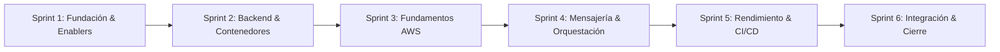

# Hoja de Ruta de Sprints

Evolución del proyecto a lo largo del programa de 6 semanas:

---

## 📌 Sprint 1: Fundación Técnica y de Datos (Cerrado)
* **EN-01**: Bosquejo de arquitectura y registros ADR.
* **EN-02**: Convenciones de repositorio y estandarización.
* **EN-03**: Prototipado analítico de preguntas de negocio.
* **EN-04**: Seed reproducible e idempotente (`services/seed_cli`).
* **EN-05**: Modelo de datos operacional MER en PostgreSQL (`infra/migrations`).

---

## 📌 Sprint 2: Backend y Contenedores (Sprint Actual)
* **HU-01**: API de solicitudes de viaje (`POST /trip-requests`, cancelación y asignación).
* **HU-02**: Simulador de telemetría GPS con defectos (`services/telemetry_simulator`).
* **HU-03**: Persistencia de conductores y vehículos con filtro legal (RN-09).
* **HU-04**: API de multiplicador vigente v1 (`services/multiplier_api`).
* **EN-06**: Dockerización y ecosistema multi-contenedor local.

---

## 📌 Sprint 3: Fundamentos AWS
* Diseño de VPC, Subredes y Security Groups.
* Despliegue de Amazon RDS PostgreSQL y Amazon MQ / RabbitMQ.
* Publicación de imágenes de contenedores en Amazon ECR.
* Estimación inicial de costos cloud (ADR-0004 y ADR-0006).

---

## 📌 Sprint 4: Mensajería, Orquestación y Procesamiento Distribuido
* Implementación del `pressure_worker` consumiendo telemetría en tiempo real.
* Integración completa de reglas climáticas (RN-04) mediante DAG horario de Airflow.
* Primer job PySpark en ECS Fargate para procesamiento de históricos (F1).

---

## 📌 Sprint 5: Optimización, CI/CD y Kubernetes
* Arquitectura Medallón completa (Bronze -> Silver -> Gold/Quarantine).
* Pipeline automatizado de CI/CD con GitHub Actions (tests unitarios y build de imágenes).
* Despliegue de microservicio en Kubernetes (EKS).

---

## 📌 Sprint 6: Analítica y Cierre End-to-End
* Conexión de Amazon Athena sobre la capa Gold en Amazon S3.
* Tablero interactivo en Power BI respondiendo las 6 preguntas estratégicas.
* Runbooks de operación, auditoría de costos final y demo end-to-end.
