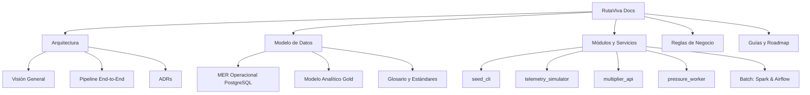

# RutaViva Mobility · Plataforma de Datos y Tarifas Dinámicas

Bienvenido al centro oficial de documentación técnica de **RutaViva Mobility**, plataforma integral para la gestión de flota (~8,000 vehículos), ingesta de telemetría GPS en tiempo real, tarificación dinámica (*surge pricing*) y analítica de datos.

---

## 🎯 Objetivos de la Plataforma

1. **Reducción del Tiempo de Espera**: Disminuir el tiempo promedio de espera en horas pico en un **25%** optimizando la asignación y reposicionamiento de la flota.
2. **Utilización Eficiente**: Aumentar la utilización de vehículos en horas valle en un **15%**.
3. **Auditoría Transaccional Inmutable**: Garantizar que cada tarifa cobrada sea reconstruible y auditable matemáticamente (factores de presión, clima, multiplicador exacto y versión de reglas).
4. **Automatización Regulatoria**: Generación periódica y automática de reportes de calidad de servicio para la autoridad de tránsito.

---

## 🏗️ Mapa de Navegación

---

## 📦 Estado Actual del Sistema (Sprint 2)

* **Infraestructura Base**: Contenedores en Docker Compose con **PostgreSQL 16** (13 entidades operacionales modeladas mediante Alembic) y **RabbitMQ 3.12**.
* **Seed CLI**: Poblamiento idempotente y determinista del catálogo espacial de NYC y conductores sintéticos con integridad referencial.
* **Simulador de Telemetría**: Motor asíncrono con R-Tree espacial (`GeoPandas`) publicando cada 15s hacia RabbitMQ con inyección configurable de defectos (silenciosos y fuera de ciudad - `HU-02`).
* **API de Multiplicador v1**: Microservicio FastAPI en capas con degradación segura ante caídas de servicio (`RNF-04`).
