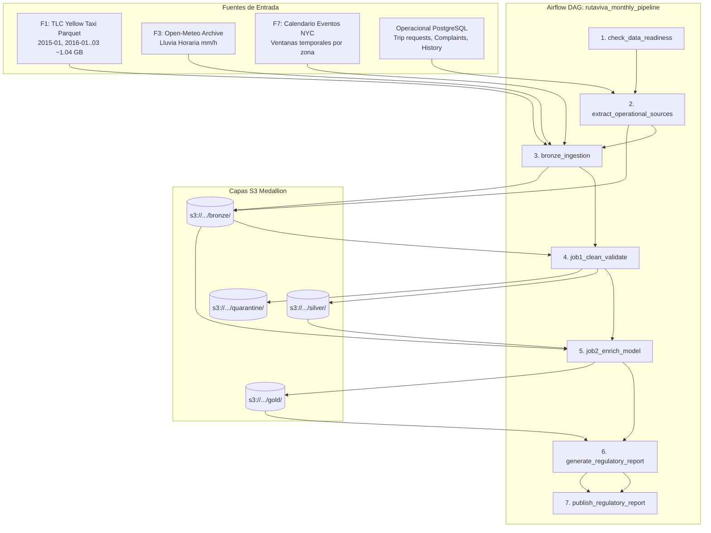

# Procesamiento Batch (`batch/`)

El módulo batch contiene los trabajos analíticos distribuidos con **Apache Spark (PySpark)** y la orquestación automatizada de flujos de trabajo con **Apache Airflow**.

---

## 1. Arquitectura del Flujo Batch y Data Lake Medallón

El pipeline batch implementa una arquitectura Medallón desacoplada sobre **Amazon S3** (`s3://ruta-viva-datalake-226d5e27/`), asegurando idempotencia, calidad de datos y trazabilidad:

---

## 2. Jobs de Apache Spark (`batch/spark_jobs/`)

### `job1_clean_validate.py`: Limpieza, Validación y Evolución de Esquema
* **Entrada**: Datos masivos de viajes históricos de NYC Yellow Taxi (F1) desde `bronze/f1/`.
* **Detección Dinámica de Formato**: Infiere automáticamente el formato a partir de la extensión del archivo (`.parquet`, `.csv`, `.json`), permitiendo procesar indistintamente datasets históricos Parquet y archivos operativos CSV.
* **Evolución de Esquemas (2015 vs. 2016+)**:
  * Los viajes anteriores a julio de 2016 utilizaban coordenadas GPS (`pickup_longitude`, `pickup_latitude`, `dropoff_longitude`, `dropoff_latitude`).
  * Los viajes posteriores utilizan códigos de zona (`PULocationID`, `DOLocationID`).
  * El job mapea alias canónicos (`F1_COLUMN_ALIASES`) y realiza un `unionByName(..., allowMissingColumns=True)` preservando coordenadas cuando las zonas son nulas.
* **Compuertas de Calidad y Cuarentena (RN-01 a RN-07)**:
  * Los registros válidos se escriben en `silver/trips/year=YYYY/month=MM/` en formato Parquet Snappy.
  * Los registros anómalos (distancia $\le 0$, tarifa base $< 0$, fechas fuera del mes, coordenadas fuera de NYC) se aíslan en `quarantine/trips/year=YYYY/month=MM/` con la columna explicativa `reject_reason`.

### `job2_enrich_model.py`: Enriquecimiento Geoespacial y Modelo Dimensional Gold
* **Enriquecimiento Geoespacial por Shapefile**:
  * Para los registros con coordenadas GPS (2015-01 y primer trimestre de 2016), distribuye el shapefile oficial de las 263 zonas de taxi de NYC mediante `sparkContext.broadcast`.
  * Utiliza un índice espacial `shapely.strtree.STRtree` dentro de una UDF optimizada para resolver cada par `(lat, lon)` al `LocationID` oficial en memoria local con complejidad $O(\log N)$.
* **Cruce Horario con Clima (F3)**:
  * Trunca el timestamp del viaje a la hora exacta (`date_trunc("hour", tpep_pickup_datetime)`).
  * Realiza un `LEFT JOIN` con `DIM_WEATHER` por `weather_hour`, asignando la clave foránea `weather_key` y la categoría de lluvia (`low`, `moderate`, `heavy`, `extreme`).
* **Cruce con Eventos Especiales (F7)**:
  * Aplica un `left_semi` join contra las ventanas de eventos `starts_at <= tpep_pickup_datetime < ends_at` en la zona correspondiente, marcando el flag `is_special_event = True`.
* **Generación del Modelo Dimensional Gold**:
  * **Dimensiones**: `DIM_DATE`, `DIM_TIME_SLOT`, `DIM_WEATHER`, `DIM_ZONE`.
  * **Hechos**: `FACT_TRIP` (granularidad por viaje individual con métricas y claves foráneas) y `FACT_ZONE_INTERVAL` (presión y demanda agregada por intervalo).
  * **Reporte Regulatorio**: `RN11_MONTHLY_REPORT` con métricas agregadas por distrito para la autoridad de tránsito.

---

## 3. DAG Principal de Apache Airflow: `rutaviva_monthly_pipeline`

El DAG mensual se ejecuta automáticamente a las **03:00 (America/New_York) el día 2 de cada mes** y comprende 7 tareas atómicas secuenciales:

| # | Tarea | Función / Script | Propósito y Mecanismo |
|---|---|---|---|
| 1 | `check_data_readiness` | `validate_pipeline_inputs()` | Valida en < 2s que las variables S3 apunten a buckets válidos, que existan fuentes F1, F3, F7 y que los shapefiles existan antes de ejecutar cómputo. |
| 2 | `extract_operational_sources` | `extract_monthly_operational_data()` | Extrae solicitudes, quejas y estados de zona desde PostgreSQL (`rutaviva_postgres`) para el mes evaluado y genera CSVs en landing. |
| 3 | `bronze_ingestion` | `ingest_bronze()` | Sube archivos de landing a S3 Bronze (`s3://.../bronze/`). **Idempotente**: consulta `head_object` y omite archivos sin cambios mediante metadatos `source-size` y `source-mtime-ns`. |
| 4 | `job1_clean_validate` | `submit_spark_job(job1)` | Ejecuta PySpark Job 1 para normalizar F1, filtrar reglas de calidad y escribir Silver y Quarantine en S3. |
| 5 | `job2_enrich_model` | `submit_spark_job(job2)` | Ejecuta PySpark Job 2 para indexación geoespacial, cruce con clima F3 y eventos F7, y publicación de tablas Gold en S3. |
| 6 | `generate_regulatory_report` | `generate_regulatory_report.py` | Lee `RN11_MONTHLY_REPORT` desde Gold y genera los reportes consolidados en JSON y CSV por distrito. |
| 7 | `publish_regulatory_report` | `publish_regulatory_report()` | Valida la integridad de los reportes generados y los publica en la ruta regulatoria final `s3://.../gold/reports/year=YYYY/month=MM/`. |

---

## 4. Resolución de Desafíos Técnicos e Infraestructura

### Conector S3A y Configuración Hadoop-AWS
Para permitir que PySpark lea y escriba directamente en Amazon S3 bajo el protocolo `s3a://`:
* Se configuró dinámicamente el conector `org.apache.hadoop:hadoop-aws:3.5.0` mediante `SPARK_JARS_PACKAGES`.
* Se configuró `org.apache.hadoop.fs.s3a.S3AFileSystem` con soporte para VPC Gateway Endpoints en la región `us-east-1`.

### Aislamiento del Intérprete Python en PySpark Workers
Para evitar colisiones entre el Python del sistema operativo host (`/usr/bin/python3`) y el entorno virtual (`.venv`):
* En `common/spark_session.py`, se estableció `spark.pyspark.python` y `spark.pyspark.driver.python` referenciando `sys.executable`.
* Esto garantiza que librerías científicas como `pyarrow` y `shapely` estén siempre presentes tanto en el driver como en los ejecutores locales.

### Paridad de Entornos (Docker vs. AWS EC2)
* En el entorno local, Airflow corre con Docker Compose sobre `rutaviva-airflow:3.3.2`, Redis y base de metadatos `airflow-db` dedicada.
* En AWS, se ejecuta en la instancia compartida `t4g.medium` (NAT + Airflow + Spark Local), optimizando costos a menos de \$25 USD/mes frente a los \$150+ USD/mes de EMR y Managed NAT Gateways.
