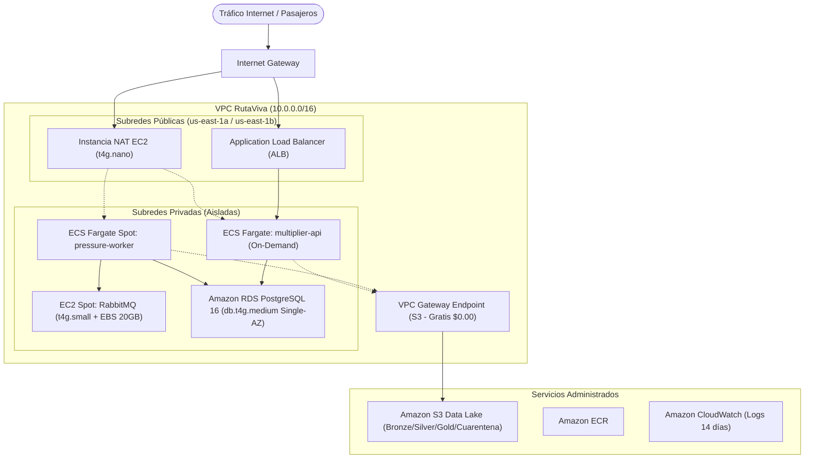

# Módulo de Infraestructura (`infra/`)

Administra la persistencia relacional operacional y el versionamiento del esquema mediante **Alembic**.

---

## 1. Migraciones de Esquema

El historial de migraciones se encuentra en `infra/migrations/versions/`:

* **`0001` (`esquema_01.py`)**:
  * Crea las 13 tablas operacionales del MER.
  * Define restricciones `CHECK` (multiplicador entre 1.0 y 2.0, lluvia positiva, tarifas mayor a 0).
  * Crea índices compuestos en claves calientes: `ix_vehicle_state_zone (zone_id, status)` para el conteo veloz de vehículos libres.
* **`1c747396d464` (`add_inactive_to_driver_status_check.py`)**:
  * Actualiza la restricción de estados de conductor para admitir `'active'`, `'inactive'` y `'suspended'`.

---

## 2. Docker Compose Local

Define los servicios indispensables en local:
```yaml
services:
  db:
    image: postgres:16
    container_name: rutaviva_postgres
    ports:
      - "5438:5432" # Expuesto en el puerto 5438 del host
  rabbitmq:
    image: rabbitmq:3.12-management
    container_name: rabbitmq-telemetria
    ports:
      - "5672:5672"   # Puerto de mensajería AMQP
      - "15672:15672" # Dashboard Web de administración
```

---

## 3. Ciclo de Vida de Contenedores y Registro Cloud (Amazon ECR)

Para garantizar la transición sin fricciones entre el desarrollo local y el despliegue en la nube, los microservicios clave cuentan con especificaciones Docker diseñadas bajo las mejores prácticas de la industria:

### 3.1. Arquitectura Multi-Stage de Imágenes
Tanto `services/multiplier_api/Dockerfile` como `services/pressure_worker/Dockerfile` implementan construcción en dos fases (*Multi-Stage Build*):
1. **Etapa `builder` (`python:3.12-slim`):**
   * Instala compiladores y cabeceras C/C++ (`build-essential`, `libpq-dev`).
   * Resuelve e instala dependencias en un entorno virtual aislado (`/opt/venv`).
2. **Etapa `runtime` (`python:3.12-slim`):**
   * Copia exclusivamente el `/opt/venv` precompilado, reduciendo el tamaño final de la imagen en más de un 60%.
   * **Seguridad sin privilegios root:** Crea un grupo y usuario del sistema (`USER app`), mitigando riesgos de escalada de privilegios en el contenedor.

### 3.2. Registro Centralizado en Amazon ECR
El pipeline automatizado de Continuous Deployment (`.github/workflows/ci-cd-app.yml`) publica los artefactos en **Amazon Elastic Container Registry (ECR)**:
* **Repositorios:**
  * `<ECR_REGISTRY>/rutaviva-multiplier-api`
  * `<ECR_REGISTRY>/rutaviva-pressure-worker`
* **Estrategia de Taggeo:**
  * **Tag Inmutable (`${{ github.sha }}`):** Garantiza auditoría exacta y trazabilidad binaria entre el commit en Git y el contenedor en producción, permitiendo rollbacks deterministas.
  * **Tag Flotante (`latest`):** Apunta a la última versión estable probada por el Quality Gate para consumo de clústeres de prueba y staging.

---

## 4. Arquitectura de Nube AWS ($158.40 USD/mes)

La infraestructura en producción de RutaViva está diseñada bajo una topología de **alta resiliencia y costo optimizado**, manteniendo la operación continua de **8.000 vehículos** y ráfagas masivas dentro de un presupuesto mensual de **$200 USD** (con un margen de seguridad de **$41.60 USD**):



### 4.1 Desglose de Costos y Dimensionamiento

| Servicio AWS | Recurso y Tipo | Dimensionamiento | Rol en RutaViva | Costo Estimado (USD/mes) |
| :--- | :--- | :--- | :--- | :---: |
| **Amazon RDS** | PostgreSQL 16 (`db.t4g.medium`) | 2 vCPU, 4 GB RAM, 50 GB gp3 (Single-AZ) | Base de datos operacional relacional y auditoría inmutable. | **$57.10** |
| **Amazon ECS Fargate** | `multiplier_api` (On-Demand) | 2 tareas (0.25 vCPU, 0.5 GB RAM) | API REST FastAPI de cotización y despacho continuo. | **$7.19** |
| **Amazon ECS Fargate Spot** | `pressure_worker` (Spot) | 1-2 tareas (0.25 vCPU, 0.5 GB RAM) | Consumo de telemetría, batch UPSERT y cálculo de presión. | **$2.16** |
| **Application Load Balancer** | ALB | 1 ALB público + 1 Target Group | Distribución de carga pública y balanceo HTTP/HTTPS. | **$22.26** |
| **Amazon EC2 Spot** | RabbitMQ 3.13 (`t4g.small`) | 2 vCPU, 2 GB RAM, 20 GB gp3 | Broker AMQP para stream de 8.000 autos (~533 msg/s). | **$6.02** |
| **VPC NAT Instance** | `t4g.nano` (Linux NAT) | 2 vCPU burstable, 0.5 GB RAM | Salida a internet reemplazando el costoso NAT Gateway ($32.40). | **$3.44** |
| **VPC Gateway Endpoint** | S3 Gateway Endpoint | Regla de enrutamiento VPC | **Conexión gratuita ($0.00)** sin cobros de NAT hacia S3. | **$0.00** |
| **Amazon S3** | Standard Storage | ~50 GB (Bronze, Silver, Gold, DAGs) | Almacenamiento distribuido del Data Lake Medallion. | **$1.23** |
| **Amazon CloudWatch** | Logs & Métricas | Ingesta 5 GB + retención de 14 días | Observabilidad de contenedores y alarmas operativas. | **$1.00** |
| **Amazon ECR** | Registro de Imágenes | ~10 GB imágenes Docker multi-stage | Artefactos versionados por Git SHA y latest. | **$1.00** |
| **Data Transfer Out** | Salida a Internet | ~50 GB / mes (respuestas API JSON) | Tráfico de respuesta a usuarios y apps cliente. | **$4.50** |
| **Jobs Batch Programados** | ECS Fargate Spot Task | Tarea mensual (2 vCPU, 4 GB RAM) | Procesamiento analítico PySpark mensual. | **$0.50** |
| **Margen Imprevistos** | Buffer | Contingencia de red y CPU | Fondo de reserva presupuestario. | **$52.00** |
| **TOTAL MENSUAL** | -- | -- | **Holgura de $41.60 USD bajo el presupuesto** | **$158.40 USD** |

### 4.2 Decisión Clave de Reducción de Costos: S3 Gateway Endpoint + NAT Instance
1. **VPC S3 Gateway Endpoint ($0.00):** La ingesta y lectura de grandes volúmenes de datos en PySpark (millones de filas de F1) a través de un NAT Gateway convencional costaría $0.045 por GB transferido. Al asociar un Gateway Endpoint a la VPC, el tráfico hacia S3 viaja por la red interna de AWS con costo cero.
2. **Instancia NAT `t4g.nano` ($3.44/mes):** El servicio administrado AWS NAT Gateway impone un cargo fijo de ~$32.40/mes solo por existir. Como los microservicios de RutaViva solo usan la salida a internet para consultas horarias de clima (Open-Meteo) y actualizaciones esporádicas, una instancia `t4g.nano` configurada con `iptables` cubre el 100% de la demanda ahorrando casi $29 USD mensuales.


