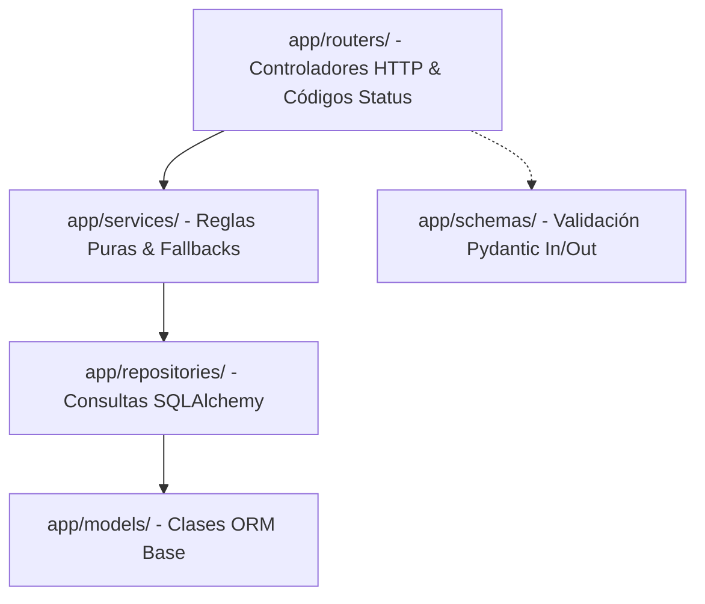
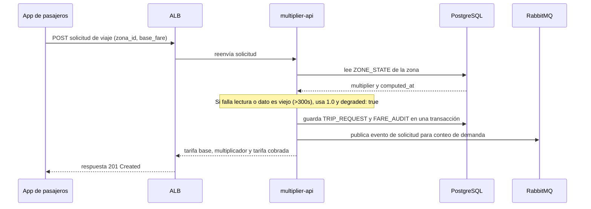
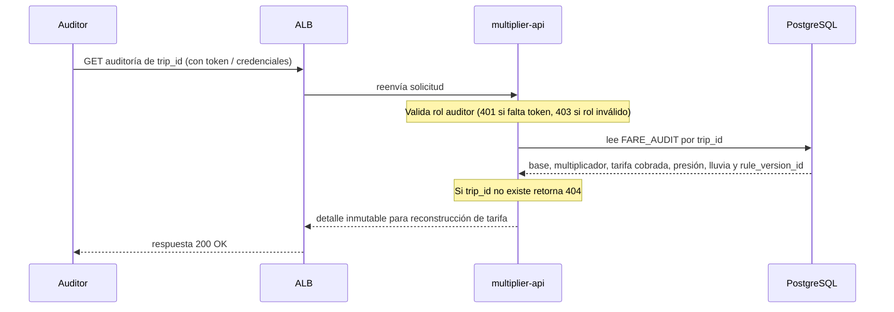

# API de Multiplicador y Tarifas (`services/multiplier_api/`)

Microservicio REST desarrollado en **FastAPI** encargado de entregar el multiplicador de tarifa vigente por zona, registrar solicitudes de viaje y permitir la auditoría de tarifas cobradas.

---

## 1. Arquitectura en Capas

El servicio sigue estrictamente el patrón de dependencias unidireccionales:
`routers` ➔ `services` ➔ `repositories` ➔ `models`

* **`routers/`**: Maneja peticiones HTTP, validación de parámetros (Path/Query) y códigos de estado.
* **`services/`**: Aplica reglas de negocio y la política de degradación segura.
* **`repositories/`**: Consultas directas de lectura/escritura en PostgreSQL con SQLAlchemy.
* **`models/`**: Clases ORM mapeadas a las tablas de la base de datos.
* **`schemas/`**: Modelos Pydantic para serialización y validación estricta de payloads JSON.

---

## 2. Endpoints del Servicio

| Método | Ruta | Actor / Uso | Descripción | Respuesta Exitosa |
|---|---|---|---|:---:|
| `GET` | `/health/live` | ALB / K8s | Sonda de vida del contenedor | `{"status": "alive"}` (200) |
| `GET` | `/health/ready` | ALB / Ops | Sonda de preparación (valida conexión a PostgreSQL) | `{"status": "ready"}` (200 / 503) |
| `GET` | `/zones/{zone_id}` | Apps / Ops | Consulta catálogo y metadata de una zona | `{"zone_id": 1, ...}` (200) |
| `GET` | `/zones/{zone_id}/multiplier` | Pasajeros | Multiplicador de tarifa dinámico vigente | `{"multiplier": 1.25, ...}` (200) |
| `POST` | `/trip-requests` | Pasajeros / Simulator | Crea solicitud, fija multiplicador y audita | `{"trip_id": "...", ...}` (201) |
| `GET` | `/audit/{trip_id}` | Auditor Interno | Reconstruye el cálculo exacto de la tarifa | `{"base_fare": 15.0, ...}` (200) |

---

## 3. Diagramas de Secuencia (Flujos de Trabajo)

### 3.1 Solicitud de Viaje (`POST /trip-requests`)

### 3.2 Auditoría de Tarifa (`GET /audit/{trip_id}`)

---

## 4. Degradación Segura (RNF-04)

Si la consulta a PostgreSQL falla o el timestamp `computed_at` excede `FRESHNESS_THRESHOLD_SECONDS` (300 segundos):
* La API **nunca responde con error 500**.
* Devuelve un multiplicador neutro **`1.0`** con la bandera **`degraded: true`**.
* Si la zona no existe en el catálogo maestro, retorna `404 Not Found`.
