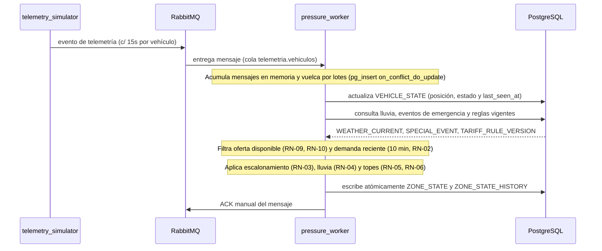

# Worker de Presión (`services/pressure_worker/`)

Componente de procesamiento en segundo plano (consumidor de RabbitMQ y motor de cálculo reactivo) encargado de procesar la telemetría vehicular continua y calcular de forma determinista la presión de demanda y el multiplicador de tarifa por zona.

---

## 1. Diagrama de Secuencia del Worker



---

## 2. Reglas del Algoritmo de Presión y Orden de Cálculo

El orden de evaluación matemático es estricto para evitar distorsiones en los topes:

1. **Oferta Disponible (Vehículos Libres)**:
   * Solo cuentan vehículos en estado `available`.
   * **Exclusión por licencia/sanción (RN-09 / CA-06)**: Se excluyen conductores suspendidos, con licencia vencida o con sanción disciplinaria vigente.
   * **Exclusión por desconexión (RN-10)**: Se excluyen vehículos cuyo `last_seen_at` tenga una antigüedad mayor a 2 minutos (120 segundos).
2. **Demanda Reciente**:
   * Total de solicitudes en `trip_request` originadas en la zona en los últimos 10 minutos (`requests_last_10min`, **RN-02**).
3. **Índice de Presión**:
   ```text
   Presión = Demanda / max(Oferta, 1)
   ```
   *(Si Oferta = 0 y Demanda > 0, se asigna presión 4.0; si Oferta = 0 y Demanda = 0, presión 1.0).*
4. **Escalón Base (RN-03)**:
   - Presión menor a 1.2 $\to$ `1.0x`
   - Presión entre 1.2 y 2.0 $\to$ `1.2x`
   - Presión entre 2.0 y 3.0 $\to$ `1.5x`
   - Presión mayor a 3.0 $\to$ `1.8x`
5. **Factor Lluvia (RN-04)**: Si la lluvia en `weather_current` es mayor a 2.0 mm/h, sube un escalón adicional ($1.0 \to 1.2 \to 1.5 \to 1.8 \to 2.0$).
6. **Topes Regulatorios (RN-05)**: Se aplica el tope máximo absoluto de **2.0** y el tope para franjas nocturnas (22:00 a 05:00) de **1.5**.
7. **Contingencias y Emergencia (RN-06 / CA-03)**: Si `special_event.is_emergency = true`, la tarifa se fuerza obligatoriamente a **1.0** sin importar la presión calculada.

> **Caso de Referencia (CA-02)**: Presión 3.5, lluvia 5.0 mm/h, hora 23:30 $\to$ Multiplicador resultante = **1.5**.

---

## 3. Comportamiento ante Problemas Operacionales

| Situación | Comportamiento del Worker | Criterio de Calidad |
|---|---|---|
| **Mensaje duplicado** | Se descarta agrupando por `vehicle_id` y conservando el más reciente. | Idempotencia |
| **Volcado masivo** | Inserciones en bloques de hasta 500 registros con `ON CONFLICT DO UPDATE`. | Rendimiento de base de datos |
| **Coordenadas fuera de ciudad** | Se persiste con `zone_id = NULL` y no computa dentro de la oferta activa. | Filtro de integridad espacial |
| **Caída del Worker** | Los mensajes no reciben ACK y permanecen en RabbitMQ para procesarse al reiniciar. | Cero pérdida de eventos |
| **Falla de API Open-Meteo** | Se utiliza la última lectura de `weather_current`; si falta, se asume lluvia 0. | Tolerancia a fallos |

---

## 4. Ejecución del Servicio

```bash
# Ejecución en entorno local
cd services/pressure_worker
python app/main.py

# Ejecución en contenedor Docker
docker run --rm --network rutaviva-network rutaviva-pressure-worker
```
