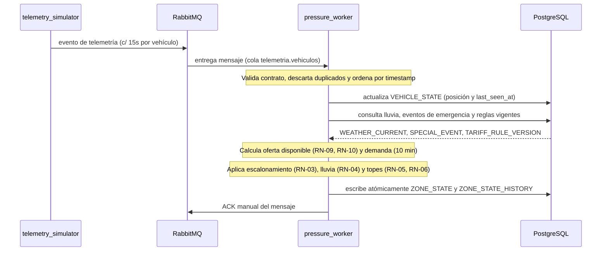

# Worker de Presión (`services/pressure_worker/`)

Componente de procesamiento en segundo plano (consumidor de RabbitMQ) encargado de calcular la presión de demanda y el multiplicador de tarifa por zona de forma reactiva y continua.

---

## 1. Diagrama de Secuencia del Worker

---

## 2. Reglas del Algoritmo de Presión y Orden de Cálculo

El orden de evaluación matemático es estricto para evitar distorsiones en los topes:

1. **Oferta Disponible (Vehículos Libres)**:
   * Solo cuentan vehículos en estado `available`.
   * **Exclusión por licencia/sanción (RN-09)**: Se excluyen conductores suspendidos, con licencia vencida o sanción vigente.
   * **Exclusión por desconexión (RN-10)**: Se excluyen vehículos cuyo `last_seen_at` tenga una antigüedad mayor a 2 minutos.
2. **Demanda Reciente**:
   * Total de solicitudes en `trip_request` originadas en la zona en los últimos 10 minutos (`requests_last_10min`).
3. **Índice de Presión**:
   `Presión = Demanda / max(Oferta, 1)`
   *(Si Oferta = 0 y Demanda > 0, se asigna presión máxima; si Oferta = 0 y Demanda = 0, presión 1.0).*
4. **Escalón Base (RN-03)**: Asignación según tramos de presión (`1.0x` a `1.8x`).
5. **Factor Lluvia (RN-04)**: Si la lluvia en `weather_current` es mayor a 2.0 mm/h, sube un escalón adicional.
6. **Topes Regulatorios (RN-05)**: Se aplica el tope máximo absoluto de **2.0** y el tope para franjas nocturnas.
7. **Contingencias y Emergencia (RN-06)**: Si `special_event.is_emergency = true`, la tarifa se fuerza a **1.0** sin importar la presión calculada.

> **Caso de Referencia (CA-02)**: Presión 4.0, lluvia 5.0 mm/h, hora 23:30 -> Multiplicador resultante = **1.5**.

---

## 3. Comportamiento ante Problemas Operacionales

| Situación | Comportamiento del Worker | Criterio de Calidad |
|---|---|---|
| **Mensaje duplicado** | Se descarta comparando `vehicle_id` y `timestamp`. | Idempotencia |
| **Mensaje desordenado** | Se conserva únicamente el estado con el `timestamp` más reciente. | Consistencia temporal |
| **Coordenadas fuera de ciudad** | Se rechaza el mensaje y no computa dentro de la oferta activa. | Filtro de integridad espacial |
| **Caída del Worker** | Los mensajes no reciben ACK y permanecen en la cola durable de RabbitMQ para ser procesados al reiniciar. | Cero pérdida de eventos |
| **Falla de API Open-Meteo** | Se utiliza la última lectura de `weather_current`; si está expirada, se asume lluvia 0 y se emite alarma. | Tolerancia a fallos |
