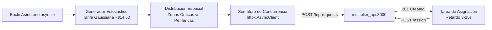

# Simulador de Solicitudes (`services/request_simulator/`)

Generador de carga sintética asíncrono encargado de emular en tiempo real el comportamiento estocástico de miles de pasajeros solicitando servicios de transporte mediante la aplicación móvil (**Fuente F5 / Historia HU-01**).

---

## 📌 1. Responsabilidades del Servicio

* **Generación Continua de Demanda**: Emite llamadas concurrentes hacia `POST /trip-requests` de la `multiplier_api` con tasas regulables (por defecto 8 a 15 solicitudes/segundo).
* **Distribución Espacial Ponderada**: Modela mayor probabilidad de solicitudes en centros neurálgicos de la ciudad (Midtown Manhattan, Financial District, Aeropuertos JFK y LaGuardia), repartiendo el resto entre las 265 zonas de NYC TLC.
* **Simulación del Ciclo de Vida del Viaje**: Simula la aceptación del viaje por parte de conductores emitiendo `POST /trip-requests/{trip_id}/assign` tras 3 a 15 segundos.
* **Pruebas de Estrés y Ráfagas (Criterio CA-10)**: Capacidad de disparar ráfagas masivas de hasta **5,000 solicitudes en 1 minuto** para simular la salida de eventos masivos (conciertos o partidos) y verificar que no haya pérdida de mensajes ni degradación de latencia.

---

## ⚙️ 2. Arquitectura Interna



### Características Técnicas
- **Cliente HTTP Asíncrono**: Basado en `httpx.AsyncClient` con pool de conexiones persistentes (`keepalive`) y control de saturación mediante `asyncio.Semaphore`.
- **Generación de Tarifas**: Distribución normal gaussiana ($media = \$14.50, \sigma = \$5.00$) acotada entre \$5.00 y \$95.00.

---

## 🚀 3. Parámetros de Configuración y Ejecución

| Variable | Tipo | Por Defecto | Descripción |
|---|:---:|:---:|---|
| `API_URL` | String | `http://localhost:8000` | URL base del microservicio `multiplier_api` |
| `REQUESTS_PER_SECOND` | Float | `10.0` | Tasa de solicitudes por segundo en modo continuo |
| `CONCURRENCY_LIMIT` | Int | `50` | Máximo de peticiones HTTP en vuelo simultáneas |
| `BURST_ENABLED` | Bool | `false` | Activa ráfagas periódicas de eventos especiales |
| `BURST_REQUESTS_COUNT` | Int | `1000` | Número de solicitudes emitidas durante una ráfaga |
| `BURST_INTERVAL_SECONDS` | Int | `180` | Segundos entre ráfagas |
| `BURST_TARGET_ZONE` | Int | `161` | Zona objetivo de la ráfaga (ej. Midtown Center) |

### Comandos de Ejecución

```bash
# Ejecución directa en local
cd services/request_simulator
python app/main.py

# Ejecución de prueba de ráfaga extrema (CA-10)
REQUESTS_PER_SECOND=85.0 CONCURRENCY_LIMIT=100 python app/main.py

# Ejecución en contenedor Docker
docker run --rm --network rutaviva-network rutaviva-request-simulator
```
