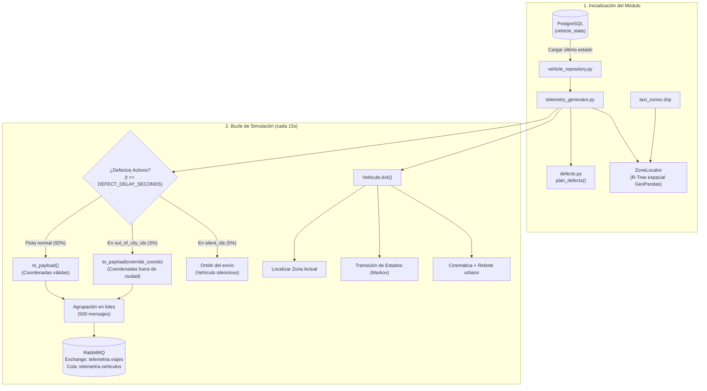

# Simulador de Telemetría GPS (`services/telemetry_simulator/`)

Motor asíncrono en Python que emula la cinemática de ~8,000 vehículos y emite pulsos de ubicación y estado cada 15 segundos hacia RabbitMQ.

---

## 1. Tareas Técnicas Cubiertas (Jira / Scrum)

* **`RWI-38` — *movement generator within zone polygons***: Cinemática polar proyectada a coordenadas decimales con rebote en las fronteras de la ciudad y resolución de zona en microsegundos mediante R-Tree (`ZoneLocator`).
* **`RWI-39` — *free/occupied/out-of-service state machine***: Máquina de estados con matriz estocástica markoviana (`available`, `busy`, `offline`, `maintenance`).
* **`RWI-40` — *injection of "silent" vehicles and invalid coordinates***: Motor de inyección de anomalías disjuntas (`silent_ids` y `out_of_city_ids`) con temporizador de retardo configurable (`DEFECT_DELAY_SECONDS`).

---

## 2. Arquitectura y Flujo de Ejecución



---

## 3. Contrato del Mensaje JSON

Los mensajes emitidos hacia el exchange `telemetria.viajes` cumplen con el siguiente contrato:

```json
{
  "vehicle_id": "4b68e547-3844-5d9c-bd18-4712534a17bd",
  "zone_id": 142,
  "lat": 40.771234,
  "lon": -73.985671,
  "status": "available",
  "last_seen_at": "2026-10-13T12:00:00.123456+00:00"
}
```

---

## 4. Pruebas Automatizadas

```bash
pytest services/telemetry_simulator/tests/ -v
```

Casos de prueba verificados:
1. `test_mensaje_tiene_los_campos_del_contrato`: Validación estricta de claves y tipos.
2. `test_los_vehiculos_siempre_se_mueven_dentro_de_la_ciudad`: Cinemática confinada en cuadrante urbano.
3. `test_porcentajes_de_defectos_son_exactos_y_disjuntos`: Verificación de conjuntos disjuntos.
4. `test_coordenadas_defectuosas_quedan_fuera_de_la_ciudad`: Validación de anomalías espaciales.
